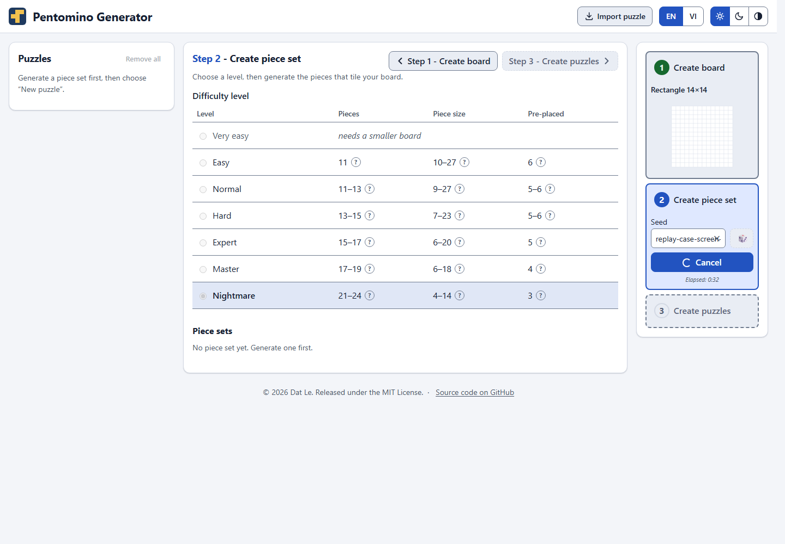
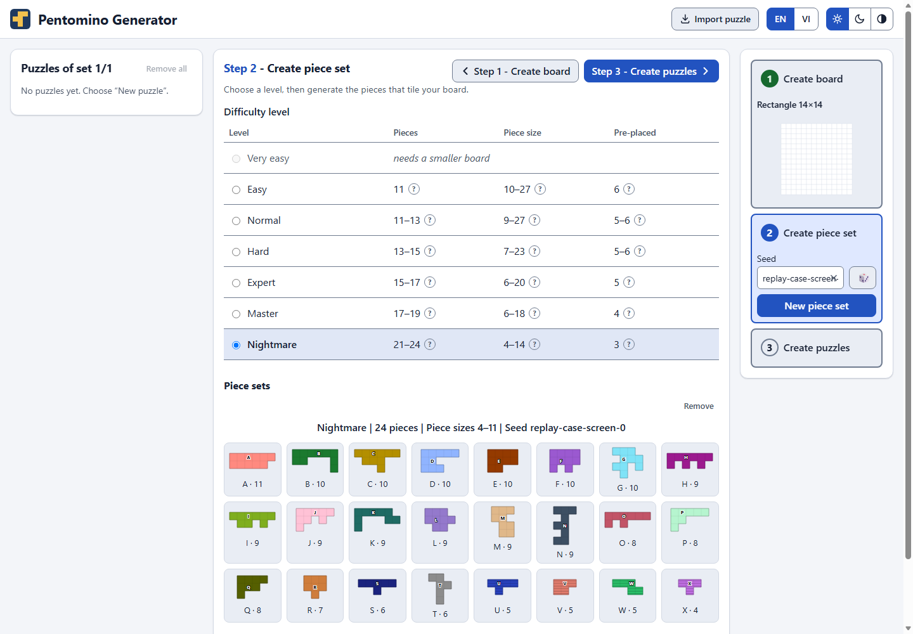
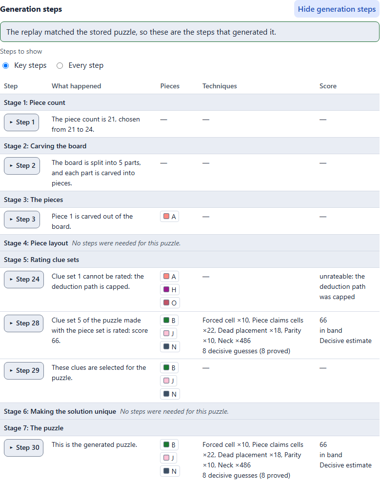
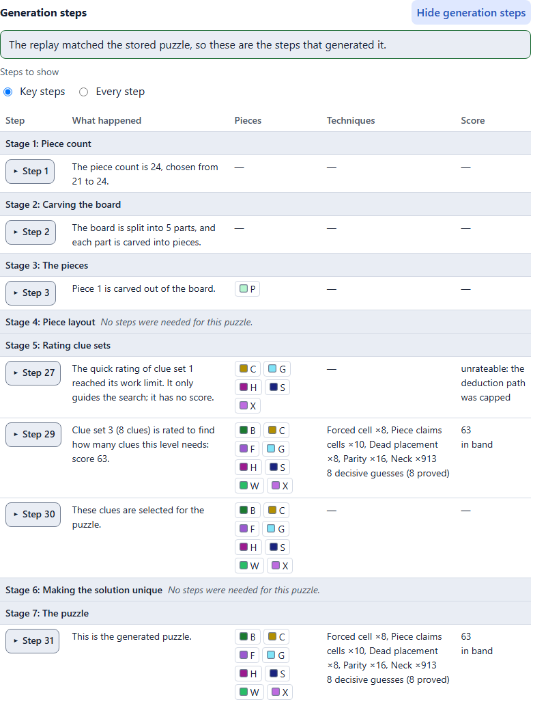
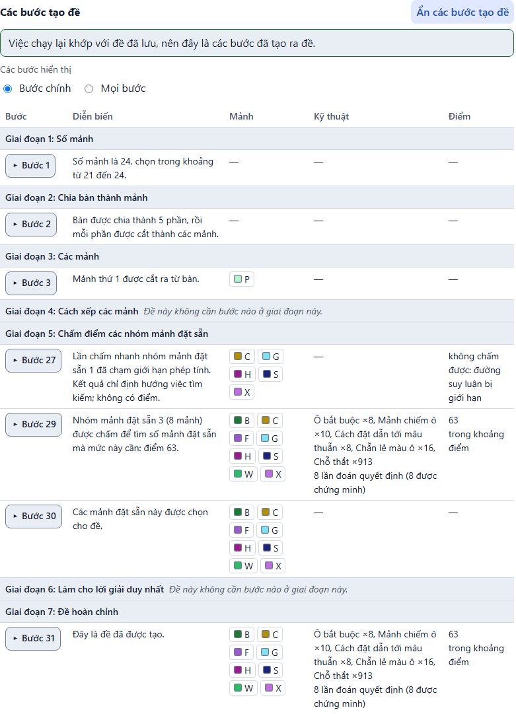

# gen-v4 in production (improve generating, phase 2)

Draft description for PR #14 (into `main`). The validation verdict is in "Validation" below, and nothing is merged.

## What changes

- **The route.** The `gen-v4` clue search (the frozen round's P1 to P5) runs in `core/` behind `selectClues` for Nightmare and
  Hell 1, except the exact full 26x26 Nightmare board (width 26, height 26, 676 active cells, whatever the display rotation).
  Every other level (Very easy to Master, Hell 2 and above) and that 26x26 board keep today's `gen-v3` search, its timers and no
  budgets. The Generator does not offer Hell 1 (phase 3). The command line also reaches boards of 577 to 675 cells, which run
  `gen-v4` (class `n-large`, no screen) **without a measurement of their own**.
- **`gen-v4`.** Every new record carries `algo: 'gen-v4'`, and the app replays `gen-v4` records only. The tables are the frozen
  `prior-s3-v1`, `screen-v4-v1` (190,000,000 units on Nightmare boards of 196 to 256 active cells, the canonical 760,000,000
  elsewhere), the per-call work budgets, the bound and the re-rating rule. The app version, the policy, the RNG, the seed scheme
  and the pack and puzzle-code formats do not change.
- **Seven keys.** A `gen-v4` record has seven provenance keys: `algo`, `policy`, `rng`, `seedScheme`, `ratingModel`, `priorTable` and
  `screenTable`, plus the `gen-v4` candidate and skip shape. `gen-v3` records keep their five keys. A set can also record a
  per-set clue-count override, `made.igPrior` (null when none was used).
- **The bound (P5).** A set request that has four attempts all ending without a clue window on the same side stops early with
  `no-window-below` or `no-window-above`, instead of running to the time limit. A call budget stop has no side. Counters for budget
  stops, screen-capped profiles and re-ratings reach the benchmark result.
- **Deadlines and the host guard.** "New piece set" and "New puzzle" each get their own scope: a 115-s generation stop and a 120-s
  hard response bound. An automatic `gen-v4`-route request of the command line or the bench uses one scope of 46 s for the set stage,
  115 s of generation and a 120-s response bound, with the host acting at 119 s. A DOM-free guard covers the whole operation,
  including pack assembly, and fences late completions by request and revision.
- **Texts.** Nine English and Vietnamese texts: the Generation steps of the clue search (locate, quick rating at its work limit,
  full re-rating, re-rating at its limit, work limit reached), the two piece-set notices and the two no-window step texts; and one
  sentence in both user guides. The living specification replaces "no fail-fast" for the `gen-v4` route.
- **Replay and fixtures.** Replay accepts `gen-v4` records, and its steps show the new events. The fixtures
  `tests/fixtures/replay-case-v4.json` (Hard) and `replay-case-v4-screen.json` (the screen) are new; `record-fixtures.mjs`
  checks the refusal of the old `replay-case.json` apart from regenerating the matched cases.
- **Tooling and documents.** `tools/ig-proto/phase2/` holds the measurement copies, the proof bundles, the driver and ledger, the
  comparator, the replay probes and the browser runner; both developer guides and the tools README describe them.

## Details of the changes

Each item names its task (`tasks/improve-generating-phase-2/`), its commit on this branch and the section (§) of the
living specification, `docs/design-detail.md`, that describes it.

### Engine (`core/engine/`)

- **`gen-v4.js`** (new): the frozen values and rules of `gen-v4`: the table ids (`prior-s3-v1`, `screen-v4-v1`,
  `budget-s3-v1`, `deadline-s3-v1`), the start-count prior, the screen's work limit, the call budgets, the bound of
  four attempts, the allowance of four re-ratings, the skip bounds, the deadline values and the route.
  P2-01 e37a052 (§7.6).
- **The cutover** (`gen-v4.js`, `version.js`): `GEN_V4_LIVE` is true and `ALGO_ID` is `gen-v4`. P2-15 0463a8e
  (§7.6, §7.7).
- **`select-v4.js`** (new): `gen-v4`'s clue search. It locates the clue count on one nested family of clue sets,
  rates with the screen on Nightmare boards of 196 to 256 active cells, re-rates screen-capped probes with the full
  limit, stops at the call budget, and ends with a side when it finds no clue window. Its results carry `counters`
  and `igWindow`, and a recorder gets the new `budget` and `no-window` events. P2-04 9d4f177; the frozen vectors and
  the parity check: P2-05a a6d5099, P2-05b 7f559d1 (§6.10).
- **`clues.js` (modified), `clue-primitives.js` (new):** `selectClues` sends the route to `selectCluesV4` and
  everything else to today's search, kept as `selectCluesV3`; the primitives both share moved to
  `clue-primitives.js`. P2-02 8a9020c, P2-04 9d4f177 (§4.2, §6.10).
- **`difficulty.js`**: `rateWithLimits` rates under a lowered work limit, and `screenCertified` tells when that
  rating is the canonical one; a capped rating only steers the search. P2-03 5b8d70d (§7.9).
- **`generate.js`, `types.js`, `protocol.js`, `tasks.js`**: a set attempt can fail with `no-window-below` or
  `no-window-above`; every selection result carries its counters; on Hell 1 a candidate starts from the per-set
  prior (`igPrior`). P2-06 8c1fd27, P2-07 eb3f697 (§6.5, §6.9).
- **`pack.js`, `replay.js`**: provenance by algorithm family (seven keys for `gen-v4`, five kept for `gen-v3`),
  `made.igPrior`, replay of `gen-v4` records only, and the `budget` and `noWindow` steps. P2-08 2d167b5,
  P2-09 739a76d (§5.5, §6.12, §7.7).

### Client, deadlines and Generator (`core/browser/`, `generator/`, `tools/`)

- **Set loop and scopes** (`generation-client.js`, `worker-pool.js`): four no-window attempts on the same side end a
  set request (the bound); a request runs on one monotonic clock scope; an automatic `gen-v4`-route request gets the
  46-s set-stage reserve. P2-06 8c1fd27, P2-10 52cce00 (§6.5, §8.4).
- **Response guard** (`generation-deadline.js`, new): one timer bounds the whole operation, pack assembly included,
  at 119 s and ignores late completions. Each Generator action (`generator/jobs.js`), the command line
  (`tools/generate.mjs`) and the bench runner use it. P2-11a 8b256b9, P2-11b 8845d14 (§8.4).
- **Texts** (`generator/locale.en.js`, `locale.vi.js`, `ui/replay-model.js`, `jobs.js`): five Generation-steps
  sentences, two no-window step texts and the notices `N-NOSET.below` and `N-NOSET.above`, in English and
  Vietnamese, as approved (D-P2-16). P2-09 739a76d (§6.12, §10.3, §10.7).
- **Saved steps** (`generator/ui/replay-cache.js`): the key holds the running provenance tuple, so steps saved by
  another version are made again. P2-08 2d167b5 (§6.12).

### Tests, fixtures and tools

- **Unit tests.** New suites `gen-v4`, `clue-primitives`, `screen-rating`, `select-v4`, `generation-deadline`,
  `replay-refusal` and `real-worker`; `generate`, `generation-client`, `worker-pool`, `protocol`, `tasks`, `pack`,
  `replay`, `replay-model`, `generator-controller`, `cli` and others grow with their tasks. The integrated worker
  cases are P2-16a 62d101a (§13.2).
- **Fixtures.** `replay-case-v4.json` (Hard) and `replay-case-v4-screen.json` (the screen) are new; the generation,
  sample-pack and UI-flow fixtures are recorded again; `replay-case.json` is unchanged and is the refusal case.
  `tools/record-fixtures.mjs` gains `--recipe screen`, `--file` and `--refusal`. P2-14a fcded78, P2-15 0463a8e
  (§13.2).
- **Browser checks.** `tests/browser/deadline.html`, a developer page that is not deployed, runs six deadline and
  text checks on the shipping UI with scripted outcomes. P2-16b fe1ac69.
- **Bench.** `tools/bench/report.js` and `runner.js` record the counters and the validation telemetry of each row.
  P2-12a ec2a217.
- **Measurement tooling** (`tools/ig-proto/phase2/`, never loaded by the app): the measurement copies, the proof
  bundles, the driver and ledger, the comparator, the replay probes and the browser runner. P2-12b to P2-12e,
  P2-13a to P2-13v, P2-14b, P2-16c and P2-16e.

### Living specification and guides

- **`docs/design-detail.md`:** §3.1, §4.2, §5.5, §6.5, §6.9, §6.10, §6.12, §7.5 to §7.9, §8.4, §10.3, §10.7,
  §13.1 and §13.2, each written by the task that changed the code; the cutover's text is P2-15 0463a8e.
- **Guides:** one sentence in `USERGUIDE.md` and `USERGUIDE.vn.md`; `DEVELOPERGUIDE.md`, `DEVELOPERGUIDE.vn.md`,
  `README.md` and `tools/ig-proto/README.md` (P2-17 fad1053, with lines from P2-12a and P2-14a);
  `docs/design-brief.md` (P2-09 739a76d).

### What the Generator shows

Each screenshot is a one-run illustration in Microsoft Edge, served locally: this branch, and `main` (served from
`6b94ffb`, which has the same tree). The request is the one of the screen fixture: a 14x14 board, Nightmare, the
seed `replay-case-screen-0`, no unique solution required. The measured times are in "Benchmark" below.

| Before (`main`) | After (this PR) |
|---|---|
|  |  |
|  |  |

- **New piece set on a formerly failing board,** 32 s after the press: `main` is still working on it; this branch
  has made it. The two builds end with different piece sets for this request: 21 pieces on `main`, 24 on this
  branch.
- **Generation steps of the first puzzle** (the set's calibration puzzle), in the default view, Key steps. On this
  branch the search locates the clue count: a quick rating that reached its work limit has no score and only guides
  the search, then a rated clue set fixes the count. `main` shows today's search and its texts. The two puzzles come
  from different piece sets, so their numbers of pre-placed pieces (3 on `main`, 8 here) do not compare; on the ten
  measured controls, `gen-v4`'s median clue share is higher on nine and equal on 26x26 (validation report §5).

- **The same steps in Vietnamese.**
- **Not shown:** the notices `N-NOSET.below` and `N-NOSET.above`. No natural bound firing was observed in this
  validation. Both notices are covered by scripted unit tests (`tests/generator-controller.test.js`), and `.below`
  also by a scripted browser check in English and Vietnamese (`tests/browser/deadline.html`, `no-window-texts`).
  Their texts are in `generator/locale.en.js` and `locale.vi.js`.

## Compatibility

- **Old records stay.** Sets, packs and histories made by `gen-v3` load and play unchanged. Nothing is restamped: an old record
  keeps its five keys through a load and a save.
- **Steps are refused by version.** The Generation steps of a `gen-v3` puzzle, and of a new puzzle made on a set saved before this
  release, are unavailable with today's reasons; `tests/fixtures/replay-case.json` stays byte for byte and replays "unavailable".
- **Forward check.** An older build reading a `gen-v4` pack drops the `made` record it cannot read, with a warning, and keeps the
  puzzles. One check with the `6b94ffb` reader, `docs/improve-generating-phase-2/evidence/P2-15/forward-check.log`, shows this.
- **Browser storage.** The saved-steps key holds the running version, so a version change does not show a stale replay.

## Validation

- **The verdict.** `Phase 2: INCOMPLETE (P2-B01 to P2-B03, P2-B05 and P2-B06: pass; P2-T01: incomplete—one eligible row without equality evidence; P2-B04: pass; P2-B07: read on 49 of 50 rows, owner continuation recorded)`
- **The owner's answer to Q-P2-V1** (2026-11-26 21:36 +07:00, Discord message 1575520697659166882): "Q-p2-v1: b",
  that is option (b), "Accept the limitation; keep PR #14 a draft — PR #14 is published with the verdict; nothing
  ships, for example until phase 3 or a `require` follow-up".
- **The equality limitation.** One eligible row, 14x14 Hell 1 rep 33, ended at the 46-s set cut with no puzzle, so it
  gives no equality evidence. Accepting the limitation does not make it a pass: the verdict stays INCOMPLETE.
- **Automatic `require` on large boards.** Such requests often end empty at the 46-s set cut (`gen-v4`: 14 of 20
  requests in the measured cells). The browser Generator does not use that cut.
- **The bound.** It was not exercised in production either: it never fired, so its false-stop rate on real requests
  is not established.
- **The ledger.** 520.920 of the 812 counted minutes were spent: stage A 252.468 of 410, stage B 268.452 of 402. The
  rest is not carried over. The full account and every measured result are in the
  [validation report](https://github.com/tdat00/pentomino/blob/gen-v4/docs/improve-generating-phase-2/validation-report.md)
  (`docs/improve-generating-phase-2/validation-report.md`).
- Hell 1 offers, browser runs on real devices and the blind play comparison belong to phase 3.

## Benchmark: puzzle generation time, before vs after

Same requests, same seeds, same machine. **Before** is today's search: the `today` arm, a measurement copy of phase
1's `6b94ffb`, which has the same tree as `main`. **After** is `gen-v4`: the `gen-v4` arm, a measurement copy of
this PR's sources at the seal (`fa0bda2`, rebased as `0320e00`). Both copies journal every clue-selection call,
rating and uniqueness count, so every time includes that cost. Each request asks for ten puzzles and does not
require a unique solution unless marked `require`. Times are wall-clock bench requests on this machine, from the
request to its answer. Ratio = before / after per seed pair. Above 1 means a shorter after-side response,
including partial outcomes—not necessarily faster production of ten puzzles. These tables cover the measured
board/level/uniqueness combinations only; unmeasured combinations have no timing claim.

**Nightmare** (20 requests per board; `require`: 5):

| Board and level | Requests reaching ten (before / after) | Response median, before | Response median, after | Response p95, before | Response p95, after | Median ratio |
|---|---|---:|---:|---:|---:|---:|
| 3x29 Nightmare | 20/20 / 20/20 | 4.51 s | 4.60 s | 8.15 s | 6.35 s | x1.01 |
| 10x10 Nightmare | 20/20 / 20/20 | 16.4 s | 11.8 s | 57.8 s | 30.6 s | x1.57 |
| 11x11 Nightmare (no prior-table cell) | 17/20 / 19/20 | 69.6 s | 33.6 s | 128.0 s | 80.5 s | x2.10 |
| 18x18 Nightmare | 18/20 / 20/20 | 30.8 s | 13.9 s | 141.1 s | 28.5 s | x1.71 |
| 18x19 Nightmare (no prior-table cell) | 19/20 / 20/20 | 19.7 s | 15.7 s | 102.7 s | 27.9 s | x1.43 |
| 18x20 Nightmare | 19/20 / 20/20 | 22.4 s | 13.6 s | 80.9 s | 29.8 s | x1.57 |
| 20x20 Nightmare | 20/20 / 20/20 | 31.3 s | 12.1 s | 67.0 s | 19.5 s | x2.68 |
| 20x21 Nightmare | 19/20 / 20/20 | 23.6 s | 15.7 s | 89.8 s | 19.6 s | x1.39 |
| 21x21 Nightmare (no prior-table cell) | 20/20 / 20/20 | 25.1 s | 17.4 s | 45.9 s | 36.0 s | x1.14 |
| 32x15 Nightmare | 20/20 / 20/20 | 9.44 s | 10.5 s | 30.5 s | 22.1 s | x1.06 |
| 22x22 Nightmare | 20/20 / 20/20 | 9.55 s | 8.69 s | 23.7 s | 15.2 s | x1.18 |
| 24x24 Nightmare | 20/20 / 20/20 | 13.1 s | 12.3 s | 34.3 s | 16.9 s | x1.22 |
| 26x26 Nightmare (today's search on both) | 20/20 / 20/20 | 11.6 s | 11.5 s | 18.0 s | 18.0 s | x1.00 |
| 22x22 Nightmare, `require` | 0/5 / 0/5 | 159.4 s | 115.0 s | 199.9 s | 115.0 s | not comparable |
| 32x15 Nightmare, `require` | 0/5 / 1/5 | 149.3 s | 46.0 s | 208.7 s | 96.3 s | not comparable |

Median of the paired response ratios over the 12 Nightmare boards on the `gen-v4` route: x1.33 (n 240).

**Master** (today's search on both arms, as on 26x26 Nightmare; 5 requests per board):

| Board and level | Requests reaching ten (before / after) | Response median, before | Response median, after | Response p95, before | Response p95, after | Median ratio |
|---|---|---:|---:|---:|---:|---:|
| 6x10 Master | 5/5 / 5/5 | 1.69 s | 1.80 s | 3.68 s | 3.47 s | x0.96 |
| 3x29 Master | 5/5 / 5/5 | 1.61 s | 1.62 s | 2.67 s | 2.67 s | x0.99 |
| 10x10 Master | 4/5 / 4/5 | 9.66 s | 9.74 s | 19.3 s | 19.6 s | x1.00 |
| 12x12 Master | 5/5 / 5/5 | 3.36 s | 3.33 s | 13.6 s | 13.4 s | x1.01 |
| 14x14 Master | 5/5 / 5/5 | 2.45 s | 2.41 s | 2.72 s | 2.74 s | x0.99 |
| 15x15b10 Master | 5/5 / 5/5 | 4.43 s | 4.23 s | 8.86 s | 8.86 s | x1.00 |
| 16x16 Master | 5/5 / 5/5 | 2.14 s | 2.12 s | 3.51 s | 3.41 s | x1.02 |
| 15x20 Master | 5/5 / 5/5 | 4.39 s | 4.38 s | 6.46 s | 6.46 s | x1.00 |
| 18x18 Master | 5/5 / 5/5 | 2.01 s | 2.05 s | 5.22 s | 5.29 s | x0.99 |
| 18x20 Master | 5/5 / 5/5 | 2.77 s | 2.79 s | 4.86 s | 4.93 s | x1.00 |
| 20x20 Master | 5/5 / 5/5 | 3.38 s | 3.41 s | 4.59 s | 4.62 s | x0.98 |
| 20x21 Master | 5/5 / 5/5 | 4.65 s | 4.68 s | 7.65 s | 7.70 s | x1.00 |
| 32x15 Master | 5/5 / 5/5 | 4.70 s | 4.64 s | 4.89 s | 4.84 s | x1.01 |
| 22x22 Master | 5/5 / 5/5 | 3.22 s | 3.23 s | 6.84 s | 6.62 s | x1.02 |
| 24x24 Master | 5/5 / 5/5 | 5.37 s | 5.33 s | 11.7 s | 11.7 s | x1.00 |
| 26x26 Master | 5/5 / 5/5 | 8.37 s | 8.34 s | 12.0 s | 12.0 s | x1.00 |

Over the 16 Master boards and 26x26 Nightmare: x1.00 (n 100), a descriptive comparison on retained
legacy search paths, not a `gen-v4` selector speedup.

- **Time limits.** On its route, `gen-v4` answers an automatic request within 120 s: the set stage is cut at 46 s,
  and generation stops at 115 s (D-P2-08). Today's search keeps its two legacy timers, so its requests can run
  longer, as several "before" p95 values above 120 s show. In the Generator each action has its own 115-s stop and
  120-s bound, with no 46-s cut.
- **`require`.** The two `require` rows compare these time limits, not speed: few requests reach ten on either side,
  so no ratio is given.
- **The gates.** The validation report's gates use the time to the tenth puzzle, capped at 120 s, with a lower bound;
  these tables are descriptive.
- **Not shown:** the smoke rows and the experimental copies (`n-mid` without the screen, the uncapped twins). They
  are not today's search; the validation report has them.

**The five formerly failing boards.** Phase 2 measured them on `gen-v4` only. Historical context only: these
baseline records predate phase 1 and are not this PR's base build. They use `gen-v3`/`mixed-v2`, runtime digest
`34cea386` and reps 0 to 19; phase 2 uses reps 20 to 39. Reported hardware, Node version, worker count and cold
lifecycle match, but seeds, sources, instrumentation and deadline policies differ. No paired speedup is inferred.
`mixed-v2` differs from `mixed-v3` only in which levels are offered (`design-detail.md` §5.4). The median and p95
are computed as above.

| Board and level | Requests reaching ten (historical / after) | Response median, historical | Response median, after | Response p95, historical | Response p95, after |
|---|---|---:|---:|---:|---:|
| 12x12 Nightmare | 17/20 / 20/20 | 65.3 s | 21.1 s | 177.0 s | 36.6 s |
| 14x14 Nightmare | 11/20 / 20/20 | 142.5 s | 8.95 s | 205.6 s | 11.5 s |
| 15x15b10 Nightmare | 11/20 / 20/20 | 124.4 s | 10.4 s | 187.9 s | 19.5 s |
| 16x16 Nightmare | 15/20 / 20/20 | 96.4 s | 7.52 s | 140.5 s | 12.3 s |
| 15x20 Nightmare | 15/20 / 20/20 | 63.7 s | 14.1 s | 153.0 s | 19.1 s |

**After only** (no "before" in these records):

| Board and level | Requests reaching ten | Response median | Response p95 | Note |
|---|---|---:|---:|---|
| 15x15 Nightmare (no prior-table cell) | 20/20 | 8.72 s | 16.1 s | a completion-only sentinel, planned without today's arm |
| 14x14 Hell 1 | 10/20 | 88.4 s | 115.1 s | not offered (phase 3); the diagnostic offer copy (D-P2-11). Historical context only, not paired: 0/20 reached ten in the landscape of 2026-11-14 |
| 20x20 Hell 1 | 20/20 | 31.7 s | 57.5 s | not offered (phase 3); the diagnostic offer copy (D-P2-11). Historical context only, not paired: 0/3 reached ten in the landscape of 2026-11-14 |
| 24x24 Hell 1 | 20/20 | 27.0 s | 46.2 s | not offered (phase 3); the diagnostic offer copy (D-P2-11). Historical context only, not paired: 0/20 reached ten in the landscape of 2026-11-14 |
| 26x26 Hell 1 | 20/20 | 17.9 s | 39.9 s | not offered (phase 3); the diagnostic offer copy (D-P2-11). Historical context only, not paired: 9/20 reached ten in the landscape of 2026-11-14 |
| 22x22 Hell 1, `require` | 0/5 | 46.0 s | 101.2 s | not offered (phase 3); the diagnostic offer copy; the uncapped copy was the only other arm |
| 32x15 Hell 1, `require` | 0/5 | 46.0 s | 101.2 s | not offered (phase 3); the diagnostic offer copy; the uncapped copy was the only other arm |

**How it was measured.**
- **Run.** Phase-2 validation, 2026-11-26 (+07:00), under the timing lock: Node v26.13.0, four workers, cold, one
  fresh process per request, on one machine (Windows, AMD EPYC 7763, 16 logical cores). Stages A and B ran at
  different times of the same day.
- **Seeds.** `landscape/<board>-<level>/<rep>`, for example `landscape/14x14-nightmare/20`: reps 20 to 39, 20
  requests per board (Master: reps 20 to 24, 5 per board). `require`: `ig-p2/require/<board>-<level>/<rep>`, reps
  0 to 4.
- **Timing.** A request that does not reach ten is timed until it stops. The p95 is interpolated between order
  statistics; with five requests it is close to the maximum.
- **Scope.** This is Node bench evidence, not a browser measurement.
- **Source.** `run.responseMs` and `run.acceptedCount` of the published rows
  [A.jsonl](https://github.com/tdat00/pentomino/blob/gen-v4/docs/improve-generating-phase-2/evidence/rows/A.jsonl) and
  [B.jsonl](https://github.com/tdat00/pentomino/blob/gen-v4/docs/improve-generating-phase-2/evidence/rows/B.jsonl);
  the historical context: `runs[].responseMs` and `runs[].acceptedCount` of the
  [landscape records](https://github.com/tdat00/pentomino/tree/gen-v4/docs/difficulty-v3/landscape-v3-full).
  Every phase-2 reading is in the validation report linked under "Validation".

## Depends on

- PR #11 is squash-merged into `main` as `626918c`. PR #14 is rebased onto it (D-P2-18) and carries only phase 2's
  commits. The measured source is sealed at `fa0bda2`, from before the rebase; its rebased counterpart, `0320e00`, has
  the identical tree (`docs/improve-generating-phase-2/evidence/rebase/rebase-map.json`).

## Not merged

- Nothing is merged, released, tagged or deployed. A merge, a release or a deployment needs the owner's explicit instruction.
