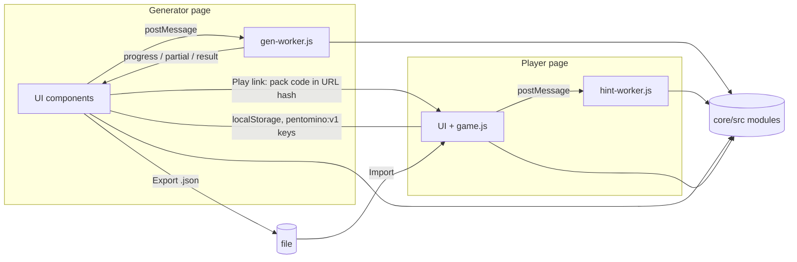
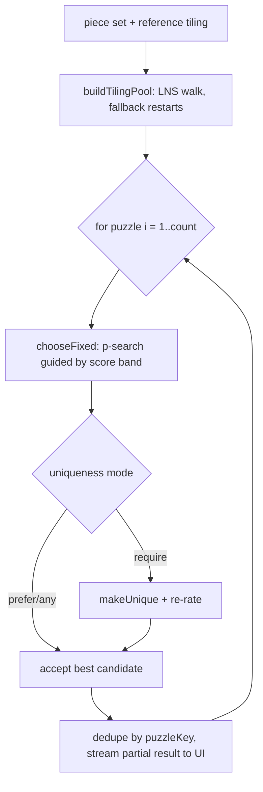
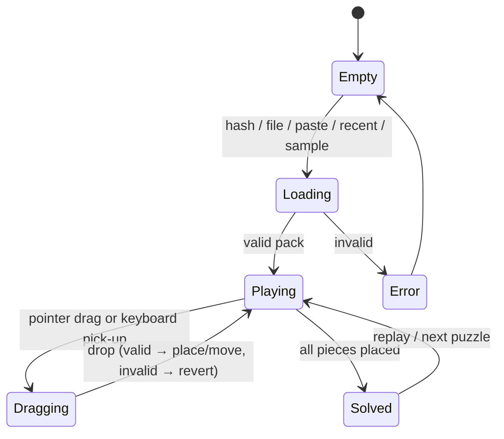

# Pentomino Puzzle Studio — Detailed Design (architect-1)

| | |
|---|---|
| Status | Proposal for cross-review (phase 1) |
| Author | architect-1 |
| Date | 2026-10-22 |
| Audience | Developers and AI coding agents implementing `core/`, `generator/`, `player/` |
| Companion | `1-design-brief-architect-1.md` (user-experience summary) |

This document is normative where it uses **MUST/SHOULD/MAY**. Constants are initial values. They
were calibrated with a throw-away prototype (see Appendix A) and are expected to be re-tuned with
`tools/calibrate.mjs` during implementation. Change them only together with the version numbers
in §9.8.

---

## Table of contents

1. Scope and goals
2. Requirements traceability
3. Assumptions and interpretations of ambiguous requirements
4. Glossary
5. Architecture overview
6. Core library: modules and public APIs
7. Data model and exchange format (v1)
8. Algorithms
9. Difficulty score (the single shared formula)
10. Performance strategy
11. Generator application
12. Generator → Player hand-off and import
13. Player application
14. Deployment (GitHub Pages)
15. Testing strategy
16. Edge cases
17. Risks and mitigations
18. Open questions
19. Phased implementation plan
- Appendix A: prototype calibration measurements
- Appendix B: references

---

## 1. Scope and goals

**Goals**

- G1. Build two independent static web apps: `generator/` and `player/`. Their shared logic lives in `core/`. There is no build step and no backend.
- G2. Let users design boards: rectangle size, blocked cells, presets, and 45°/90° rotation.
- G3. Generate random sets of distinct polyomino pieces (≥ 3 cells each) that exactly tile the board.
- G4. Generate 1–10 distinct puzzles per piece set. Each puzzle is a board, the piece set, and a list of pre-placed (fixed) pieces.
- G5. Use one deterministic difficulty score (0–100) to classify puzzles into named levels and to steer generation.
- G6. Hand puzzles from the generator to the player with a link (URL hash), a file, or local storage.
- G7. Provide a player with drag/drop, rotate/flip, keyboard and touch support, undo/redo, hints, win detection and saved progress.
- G8. Deploy to GitHub Pages at `https://tdat00.github.io/pentomino/`. The root redirects to `/pentomino/generator/`.

**Non-goals (v1)**

- Accounts, a server, online leaderboards, analytics.
- Non-square grids (hexagonal or triangular cells). Board rotation re-rasterizes onto the square grid (§8.2).
- 3-D puzzles. Manual drawing of individual pieces (possible future work, §18).

---

## 2. Requirements traceability

| # | Requirement (from `docs/local/prompt.txt`) | Where addressed |
|---|---|---|
| R1 | Two independent static sites (`generator/`, `player/`) + shared `core/` | §5.1, §5.3 |
| R2 | Design docs in `docs/` | this file |
| R3 | GitHub Pages at `tdat00.github.io/pentomino`, root → `/generator`, "Play" → player | §14, §12 |
| R4 | Pentomino/Puzzlia gameplay | §3 A1, §13 |
| R5 | Levels very easy … nightmare, hell-1, hell-2, … | §9.4 (extensible table) |
| R6 | One common difficulty score drives classification and generation of sets and puzzles | §9 |
| R7 | User-entered board size (5×12, 6×10, …) | §8.2, §11.2 |
| R8 | Block cells; rotate board 45°, 90°, … (heart-like shapes) | §8.2 |
| R9 | "Generate Piece Set": random shapes and sizes, ≥ 3 cells | §8.4 |
| R10 | 10–18 pieces per set; not too many small or too few large pieces | §8.3 (with feasibility limits) |
| R11 | Pieces can rotate/flip, fill 100 % of the board, no overlap | §8.5 (exact cover) |
| R12 | Pieces pairwise distinct under rotation and reflection; distinct colors | §8.1, §8.4, §6.11 |
| R13 | Piece count depends on difficulty | §8.3, §9.6 |
| R14 | "New Puzzle": 1–10 different puzzles from the same set, different arrangements | §8.7 |
| R15 | Random pre-placed pieces; count depends on difficulty | §8.7, §9.6 |
| R16 | Player imports generator puzzles | §12 |
| R17 | Player rotates/flips/places pieces to complete the board | §13 |

---

## 3. Assumptions and interpretations of ambiguous requirements

| ID | Topic | Decision |
|---|---|---|
| A1 | "Pentomino gameplay" | A **polyomino exact-tiling puzzle**. All playable cells must be covered by all pieces of the set, each used exactly once. Rotations (90°/180°/270°) and reflections are allowed, and pieces may not overlap. Pieces are general polyominoes of 3–10 cells, not only pentominoes. |
| A2 | "Rotate the board 45°" on a square grid | **Geometric rotation of the board outline followed by re-rasterization onto the same axis-aligned square grid** (§8.2). Cells and pieces stay axis-aligned. Multiples of 90° are exact (lossless). Odd multiples of 45° produce staircase diamonds, which, combined with blocked cells, allow heart or diamond shapes. *Rejected:* a purely visual 45° tilt. It creates no new logical shapes and makes dragging awkward. |
| A3 | "10–18 pieces" vs board area vs "≥ 3 cells" vs "pairwise distinct" | 10–18 is the **recommended** range. It is not always feasible: only 2 trominoes and 5 tetrominoes exist, so *k* distinct pieces need at least `minArea(k)` cells (§8.3). For example, a 60-cell board (6×10) holds **at most 13** distinct pieces, and 18 pieces need at least 81 cells. The actual range is computed per board. If the board is too small or too large for 10–18 pieces, the generator uses the feasible range and shows a notice. |
| A4 | Maximum piece size | Not specified by the user. Assumed **10 cells** (configurable from 6 to 10 under Advanced). Typical sizes cluster around `area / n ± 2.5`. |
| A5 | Pieces with holes | **Not allowed.** For example, the holed heptomino could only be placed around a blocked cell, which is confusing. Hole-free polyomino counts are listed in §8.3. |
| A6 | Unique solution | **Not required for validity.** The player wins with **any** complete valid tiling. The generator *prefers* unique solutions from level Normal upward. The `uniqueness` option (`any` / `prefer` / `require`) controls this (§8.8). A unique solution raises the score (§9). |
| A7 | Cross-board comparability of difficulty | The score is **absolute**: the same formula and bands apply to every board. Small boards therefore cap the reachable level (6×10 tops out around *Master*). The UI says so (§11.3). The alternative, board-relative normalization, is listed in §18. |
| A8 | "1–10 different puzzles … only change the arrangement" | Puzzles in a batch MUST have pairwise distinct **starting configurations** (fixed pieces), compared up to board symmetry. They SHOULD be based on pairwise different **tilings**, differing in ≥ `max(3, ⌈n/3⌉)` pieces. A set has exactly one puzzle with zero fixed pieces (the "open board"), so at most one puzzle per batch may have `p = 0`. |
| A9 | Pre-placed pieces in the player | Locked: they cannot be moved, rotated or removed. |
| A10 | Levels list "very easy … hell-2 …" | Nine levels are defined in a data table (§9.4). More levels (`hell-3`, …) can be added by splitting the top band. No code changes are needed. |
| A11 | UI language | English (all strings in one module per app). A Vietnamese translation is optional (§18). |
| A12 | Browser support | Evergreen browsers with ES modules in workers and `CompressionStream('deflate-raw')`: Chrome/Edge ≥ 103, Firefox ≥ 114, Safari ≥ 16.4. There is a graceful fallback for compression (§12.2). |
| A13 | Board limits | Input W, H ∈ [3, 20]. A generatable board has 12–144 playable cells and every 4-connected region has ≥ 3 cells. Above 120 cells the UI shows "generation may be slow". |
| A14 | Changing the level after generating a set | Allowed. The set keeps its piece count, and puzzles use the newly selected level. The UI warns if the set cannot reach that level (§11.3). |

---

## 4. Glossary

| Term | Meaning |
|---|---|
| Cell | Unit square at integer coordinates `(x, y)`. `x` grows right (column) and `y` grows down (row). Linear index `i = y·W + x`. |
| Board | A `W×H` grid with a mask of **playable** cells. Non-playable cells are either *holes* (enclosed, drawn as blocked) or *outside* (not drawn). |
| Piece | A connected, hole-free polyomino with 3–10 cells, a stable id `A…R`, and a color. Its base cells are normalized (§8.1). |
| Piece set | `n` pairwise non-congruent pieces whose total area equals the board's playable area. |
| Transform `t` | One of the 8 symmetries of the square (dihedral group D4), encoded 0–7 (§8.1). |
| Placement | `{piece, t, x, y}`. The piece's base cells, transformed by `t`, normalized, then translated by `(x, y)`. |
| Tiling / solution | A set of placements, one per piece, that exactly covers the playable cells. |
| Fixed piece | A placement given in the puzzle (pre-placed, locked). |
| Puzzle | `(board, piece set, fixed placements)` plus metadata (score, level, a reference solution). |
| Pack | JSON document with one board, one piece set and 1..N puzzles. It is the unit of hand-off and import. |
| `m` | Pieces the player must place, `m = n − p`, where `p` = number of fixed pieces. |
| Open board | The puzzle with `p = 0`. Its score is the set's *open score*. |
| D | The difficulty score, an integer 0–100 (§9). |

---

## 5. Architecture overview

### 5.1 Repository layout

```
/                          (repository root = site root /pentomino/)
├─ index.html              redirect → ./generator/
├─ 404.html                (optional) redirect unknown paths → ./generator/
├─ package.json            {"type":"module", scripts: test/serve/calibrate} — no runtime deps
├─ core/
│  ├─ src/                 pure ES modules, DOM-free, runnable in browser, worker and Node
│  │  ├─ rng.js            seeded PRNG + string hashing
│  │  ├─ geometry.js       D4 transforms, normalization, canonical keys, outlines
│  │  ├─ board.js          Board model, regions, symmetries, validation
│  │  ├─ board-shape.js    rotation/rasterization, presets, shape-editor state
│  │  ├─ dlx.js            Dancing Links exact-cover engine (node budgets, seeded randomization)
│  │  ├─ tiling.js         board+pieces → exact cover; solve, count, random tiling, LNS perturbation
│  │  ├─ pieceset.js       piece-count ranges, size planning, carving generator
│  │  ├─ levels.js         level table (bands, targets)
│  │  ├─ difficulty.js     analyzePuzzle + scoreMetrics (the single formula)
│  │  ├─ puzzlegen.js      tiling pool, fixed-subset search, uniqueness, dedupe
│  │  ├─ format.js         pack JSON v1: build, validate, (de)serialize, share codes
│  │  ├─ palette.js        piece colors, labels, contrast helpers
│  │  ├─ game.js           player rules/state (reducer), undo/redo, win detection
│  │  └─ protocol.js       worker message type constants and validators
│  ├─ ui/                  DOM helpers shared by both apps (not imported by workers or tests)
│  │  ├─ svg.js            board/piece SVG rendering, outline paths, hole hatching
│  │  ├─ worker-client.js  request/response, progress streaming, cancel = terminate + respawn
│  │  ├─ storage.js        namespaced, quota-safe localStorage wrapper
│  │  └─ dom.js            tiny helpers (h(), toast, download, clipboard)
│  └─ test/                node:test suites (excluded from the deployed site)
├─ generator/
│  ├─ index.html  app.css  main.js  strings.js  state.js
│  ├─ components/          board-editor.js level-picker.js pieceset-view.js puzzle-list.js progress.js
│  └─ gen-worker.js        module worker: imports core/src/*
├─ player/
│  ├─ index.html  app.css  main.js  strings.js
│  ├─ views/               board-view.js tray-view.js toolbar.js import-view.js win-dialog.js
│  ├─ input/               pointer.js keyboard.js
│  ├─ samples/             sample-pack.json (first-visit demo)
│  └─ hint-worker.js       module worker: solver for hints
├─ tools/                  calibrate.mjs, stamp-version.mjs (deploy-time cache busting)
├─ .github/workflows/pages.yml
└─ docs/                   design documents (not deployed)
```

### 5.2 Runtime architecture



- All computation (generation, rating, hint solving) runs in **module Web Workers**, so the UI stays responsive (§10).
- `core/src` modules MUST NOT touch `window`, `document` or `localStorage`. This lets them run in workers and under `node --test`.
- Both apps import core with **relative paths**, such as `import { … } from '../core/src/tiling.js'`. This works at `/pentomino/…` on Pages and at `/` locally (§14).

### 5.3 Technology choices

| Choice | Decision | Rationale |
|---|---|---|
| Language | Plain modern JavaScript (ES2022) with JSDoc types and `// @ts-check` | No build step. Editors still type-check. Optionally run `tsc --noEmit` in CI. |
| Modules | Native ES modules, `<script type="module">`, module workers | Shared `core/` without bundling. Supported by all target browsers. |
| Rendering | **SVG** (viewBox in cell units) | Crisp at any size, easy hit-testing, ≤ 200 cells × ≤ 18 pieces is cheap. Canvas is not needed. |
| Input | Pointer Events + keyboard | One code path for mouse, touch and pen. |
| Styling | Plain CSS with custom properties, `prefers-color-scheme` | No framework. |
| Tests | `node --test` + `node:assert` | Zero dependencies (§15). |
| Dependencies | **None at runtime.** Dev-only tools (Playwright, http-server) are optional. | Keeps GitHub Pages deployment trivial. |

---

## 6. Core library: modules and public APIs

Signatures use TypeScript-like notation inside JSDoc. All functions are pure unless stated
otherwise. Shared types:

```ts
type XY = [number, number];                       // [x, y]
type Rng = { next(): number;  int(n: number): number;  pick<T>(a: T[]): T;
             shuffle<T>(a: T[]): T[];  fork(label: string): Rng; };
type Board = { width: number; height: number; cells: Uint8Array };   // 1 = playable, row-major
type Piece = { id: string; color: string; cells: XY[] };              // cells normalized (§8.1)
type Placement = { piece: string; t: number; x: number; y: number };
type PieceSet = { id: string; level: string; seed: string; openScore: number; pieces: Piece[] };
type Metrics = { piecesToPlace: number; freeCells: number; searchNodes: number;
                 solutions: number; solutionsExact: boolean; meanOrientations: number;
                 components: { place: number; search: number; unique: number; flip: number } };
type Rating = { score: number; level: string; metrics: Metrics };
type Puzzle = { id: string; name: string; level: string; score: number; metrics: Metrics;
                fixed: Placement[]; solution: Placement[] };
```

### 6.1 `rng.js`

```ts
export function hash32(str: string): number;                 // FNV-1a 32-bit (uint32)
export function seedFromString(str: string): [number,number,number,number]; // cyrb128
export function createRng(seed: string | number): Rng;      // sfc32; next() ∈ [0,1)
export function randomSeedString(): string;                 // crypto.getRandomValues → "k7q2-9mxa"
```

- `fork(label)` derives an independent stream from `seedFromString(parentSeed + '/' + label)`. Use it for per-puzzle and per-phase determinism (§10.4).
- MUST use integer arithmetic only (`Math.imul`, `>>> 0`), so results are bit-identical across engines. `Math.random` MUST NOT be used in `core/src`.

### 6.2 `geometry.js`

```ts
export const TRANSFORMS: ReadonlyArray<(p: XY) => XY>;   // index t = 4·f + r (§8.1)
export function transformCells(cells: XY[], t: number): XY[];
export function normalizeCells(cells: XY[]): XY[];        // translate to min 0, sort by (y, x)
export function orientedCells(cells: XY[], t: number): XY[];   // normalize(transform)
export function shapeKey(cells: XY[]): string;            // "x,y;x,y;…" of normalized cells
export function canonicalKey(cells: XY[]): string;        // lexicographic min shapeKey over 8 t
export function distinctOrientations(cells: XY[]): { t: number; cells: XY[] }[]; // 1|2|4|8, minimal t each
export function canonicalT(cells: XY[], t: number): number;    // smallest t' giving same oriented shape
export function rotateCW(t: number): number;  export function rotateCCW(t: number): number;
export function flipH(t: number): number;     export function flipV(t: number): number;
export function isConnected(cells: XY[]): boolean;
export function hasHole(cells: XY[]): boolean;
export function bbox(cells: XY[]): { w: number; h: number };
export function outlineLoops(cells: XY[]): XY[][];        // boundary polygons (for SVG paths)
```

### 6.3 `board.js`

```ts
export function boardFromRows(rows: string[]): Board;     // '#' playable, '.' not
export function boardToRows(b: Board): string[];
export function rectangleBoard(w: number, h: number): Board;
export function cropBoard(b: Board): Board;               // trim empty border rows/cols
export function playableCount(b: Board): number;
export function regions(b: Board): number[][];            // 4-connected playable regions (cell indices)
export function holeMask(b: Board): Uint8Array;           // non-playable cells enclosed by playable ones
export function boardSymmetries(b: Board): number[];      // t ∈ 0..7 mapping the mask onto itself (always contains 0)
export function cellMapForTransform(b: Board, t: number): Int32Array; // cell index → transformed index (t must be a symmetry)
export function validateForGeneration(b: Board, limits?: Limits):
  { ok: boolean; errors: Issue[]; warnings: Issue[] };    // §8.2.5
```

### 6.4 `board-shape.js`

```ts
export function rotateBoard(b: Board, angleDeg: number): Board;   // multiple of 45; §8.2.2
export function mirrorBoard(b: Board, axis: 'h' | 'v'): Board;
export function presetBoard(id: PresetId, params: { size?: number; w?: number; h?: number }): Board;
export function dropTinyRegions(b: Board, minSize = 3): { board: Board; dropped: number };
// Shape-editor state: lossless rotation until the next cell edit (§8.2.3)
export type ShapeState = { source: Board; angle: number; preset: PresetId | null };
export function shapeDisplay(s: ShapeState): Board;
export function shapeRotate(s: ShapeState, deltaDeg: number): ShapeState;
export function shapeToggle(s: ShapeState, x: number, y: number, value?: 0 | 1): ShapeState;
export function shapeResize(s: ShapeState, w: number, h: number): ShapeState;
```

### 6.5 `dlx.js`

```ts
export class ExactCover {
  constructor(numColumns: number, rows: ArrayLike<number>[]);   // all columns primary
  solve(opts?: {
    maxSolutions?: number;        // default 1
    nodeLimit?: number;           // default Infinity; a "node" = one row selection
    rng?: Rng | null;             // null → deterministic; else random MRV tie-break + row order
    onSolution?: (rowIds: number[]) => void;
    onProgress?: (nodes: number) => void; progressEvery?: number;  // default 50 000
  }): { count: number; solutions: number[][]; nodes: number; exhausted: boolean; aborted: boolean };
}
```

`exhausted` means the entire search space was explored (the count is exact). `aborted` means the
node limit was hit. The structure is restored after every `solve` call, so the same instance can be
solved repeatedly.

### 6.6 `tiling.js`

```ts
export function placementCells(piece: Piece, pl: Placement, boardWidth: number): number[];
export function buildProblem(b: Board, pieces: Piece[], fixed: Placement[]):
  { cover: ExactCover; rowPlacements: Placement[]; freePieces: string[]; freeCells: number };
export function solve(b, pieces, fixed, opts: { maxSolutions?, nodeLimit?, rng? }):
  { solutions: Placement[][]; count: number; exhausted: boolean; nodes: number };
export function countSolutions(b, pieces, fixed, opts: { cap: number; nodeLimit: number }):
  { count: number; exact: boolean; nodes: number; witnesses: Placement[][] };
export function randomTiling(b, pieces, rng, opts?: { fixed?: Placement[]; totalNodeBudget?: number;
  restartBase?: number }): Placement[] | null;              // Luby restarts (§8.5.4)
export function perturbTiling(b, pieces, tiling: Placement[], rng, opts: { k: number; nodeLimit: number }):
  Placement[] | null;                                      // LNS step (§8.7.2)
export function tilingDistance(b, a: Placement[], c: Placement[], symmetries: number[]): number;
export function isValidTiling(b, pieces, tiling: Placement[]): boolean;
```

### 6.7 `pieceset.js`

```ts
export const MIN_PIECE_SIZE = 3;
export const HOLE_FREE_COUNTS = {3:2, 4:5, 5:12, 6:35, 7:107, 8:363, 9:1248, 10:4460};
export function minAreaForCount(k: number): number;                  // §8.3
export function pieceCountRange(area: number, maxPieceSize = 10):
  { min: number; max: number; withinRecommended: boolean };
export function pieceCountForLevel(area: number, levelIndex: number, maxPieceSize = 10): number;
export function planSizes(area: number, n: number, rng: Rng, maxPieceSize = 10): number[] | null;
export function carve(b: Board, n: number, rng: Rng, opts?: { maxPieceSize?; stepBudget?; growthTries?; attempts? }):
  { shapes: XY[][]; tiling: { shapeIndex: number; cells: number[] }[] } | null;
export function generatePieceSet(b: Board, levelId: string, seed: string,
  opts?: { maxPieceSize?: number; pieceCount?: number; onProgress?: ProgressFn }):
  { pieceSet: PieceSet; referenceTiling: Placement[]; openRating: Rating; warnings: Issue[] };
```

### 6.8 `levels.js`

```ts
export type Level = { id: string; label: string; index: number; min: number; max: number;
  mTarget: number; minCells: number; uniqueness: 'any' | 'prefer' | 'require' };
export const LEVELS: ReadonlyArray<Level>;        // §9.4
export function levelById(id: string): Level;
export function levelForScore(score: number): Level;
```

### 6.9 `difficulty.js`

```ts
export const SCORE_VERSION = 1;
export const DIFFICULTY_CONFIG: Readonly<{ M_REF; W_PLACE; W_SEARCH; W_UNIQUE; W_FLIP; LOG_R_MAX;
  SOL_CAP; RUNS; FIRST_NODE_CAP; COUNT_NODE_CAP }>;
export function analyzePuzzle(b: Board, pieces: Piece[], fixed: Placement[]): Metrics;  // deterministic
export function scoreMetrics(m: Metrics): number;                                      // 0..100
export function ratePuzzle(b: Board, pieces: Piece[], fixed: Placement[]): Rating;
```

### 6.10 `puzzlegen.js`

```ts
export function generatePuzzles(args: {
  board: Board; pieceSet: PieceSet; referenceTiling: Placement[]; levelId: string;
  count: number /*1..10*/; seed: string; uniqueness?: 'any' | 'prefer' | 'require';
  excludeKeys?: string[]; onProgress?: ProgressFn; onPuzzle?: (p: Puzzle) => void;
}): { puzzles: Puzzle[]; warnings: Issue[] };
export function buildTilingPool(b, set, reference, target: number, rng, dMin: number): Placement[][];
export function chooseFixed(b, set, tiling, level, rng, opts): { fixed: Placement[]; rating: Rating; inBand: boolean } | null;
export function makeUnique(b, pieces, tiling, fixed, opts): Placement[] | null;      // §8.8
export function puzzleKey(b: Board, fixed: Placement[], pieces: Piece[], symmetries: number[]): string;
```

### 6.11 `palette.js`

```ts
export const PIECE_COLORS: readonly string[];   // 20 high-contrast colors (§13.9)
export function pieceLabel(index: number): string;          // 0→"A" … 25→"Z"
export function textColorFor(hex: string): '#000000' | '#ffffff';  // WCAG relative luminance
```

### 6.12 `format.js`

```ts
export const FORMAT_ID = 'pentomino-pack';  export const FORMAT_VERSION = 1;
export function createPack(a: { board: Board; pieceSet: PieceSet; puzzles: Puzzle[]; meta?: object }): Pack;
export function validatePack(obj: unknown): { ok: boolean; errors: string[]; pack?: Pack };
export function serializePack(p: Pack, pretty = false): string;
export function parsePack(text: string): Pack;                     // throws FormatError
export async function encodeShareCode(p: Pack): Promise<string>;   // "1z.<b64url>" | "1j.<b64url>"
export async function decodeShareCode(code: string): Promise<Pack>;
export function playerUrl(base: string | URL, code: string, index?: number): string;
export function parsePlayerHash(hash: string): { code: string; index: number } | null;
```

### 6.13 `game.js` (player rules, DOM-free reducer)

```ts
export function createGame(pack: Pack, puzzleIndex: number, saved?: SavedProgress): GameState;
export function canPlace(s: GameState, pieceId: string, t: number, x: number, y: number):
  { ok: true } | { ok: false; reason: 'outside' | 'blocked' | 'overlap' | 'fixed' };
export function reduce(s: GameState, a: Action): GameState;   // place | move | remove | orient | reset | undo | redo | hint
export function isSolved(s: GameState): boolean;
export function snapshot(s: GameState): SavedProgress;
```

### 6.14 `protocol.js` (worker messages)

| Direction | `type` | Payload |
|---|---|---|
| main → gen | `generateSet` | `{ boardRows, levelId, seed, options: { maxPieceSize, pieceCount? } }` |
| main → gen | `generatePuzzles` | `{ boardRows, pieceSet, referenceTiling, levelId, count, seed, uniqueness, excludeKeys }` |
| main → gen/hint | `rate` | `{ boardRows, pieces, fixed }` |
| main → hint | `solve` | `{ boardRows, pieces, fixed, nodeLimit, maxSolutions }` |
| worker → main | `progress` | `{ phase: 'carve' \| 'rate' \| 'pool' \| 'puzzle', done, total, note? }` |
| worker → main | `partial` | `{ puzzle }` (streamed as soon as each puzzle is ready) |
| worker → main | `result` | operation-specific result object |
| worker → main | `error` | `{ code, message }` |

Every message carries a numeric `id` (request correlation). Cancellation = `worker.terminate()`
followed by a lazy respawn. No `SharedArrayBuffer` is used, because GitHub Pages cannot send the
COOP/COEP headers it requires.

---

## 7. Data model and exchange format (v1)

### 7.1 Pack document

```jsonc
{
  "format": "pentomino-pack",          // MUST equal FORMAT_ID
  "version": 1,                         // integer major version
  "meta": {
    "app": "pentomino-generator", "appVersion": "1.0.0",
    "algoVersion": 1,                   // generation algorithms (seed reproducibility)
    "scoreVersion": 1,                  // difficulty formula (§9.8)
    "createdAt": "2026-10-22T01:40:00.000Z",
    "title": "Hard · 6×10"              // optional, display only
  },
  "board": {
    "width": 10, "height": 6,
    "rows": ["##########", "##########", "##########",
             "##########", "##########", "##########"],
    "source": { "width": 10, "height": 6, "angle": 0, "preset": "rectangle" }   // optional provenance
  },
  "pieceSet": {
    "id": "ps-1x8k2q",                  // base36 hash32(board rows + sorted canonical keys)
    "level": "hard", "seed": "k7q2-9mxa", "openScore": 55,
    "pieces": [
      { "id": "A", "color": "#e6194b", "cells": [[0,0],[1,0],[2,0],[1,1],[1,2]] },
      { "id": "B", "color": "#3cb44b", "cells": [[0,0],[0,1],[1,1]] }
      // …
    ]
  },
  "puzzles": [
    {
      "id": "pz-3m0d9a",                // base36 hash32(pieceSet.id + puzzleKey) — stable progress key
      "name": "Hard #1",
      "level": "hard", "score": 41,
      "metrics": { "piecesToPlace": 8, "freeCells": 41, "searchNodes": 34, "solutions": 1,
                   "solutionsExact": true, "meanOrientations": 7.4,
                   "components": { "place": 0.41, "search": 0.24, "unique": 1, "flip": 0.91 } },
      "fixed":    [ { "piece": "C", "t": 5, "x": 3, "y": 0 } ],
      "solution": [ { "piece": "A", "t": 0, "x": 0, "y": 0 } /* … one per piece, includes fixed */ ]
    }
  ]
}
```

A single exported puzzle is a pack with one puzzle. Field order is irrelevant.

### 7.2 Encoding rules

- `rows[y][x]` is `'#'` (playable) or `'.'` (not playable). Holes and outside cells are not distinguished in data; that distinction is computed for rendering (§13.9).
- Piece `cells` MUST be normalized: min x = min y = 0, sorted by `(y, x)`.
- Pieces are ordered by `(size desc, canonicalKey asc)` and get ids `A, B, C, …` in that order. This makes the order deterministic for a given set, which matters for §9.7.
- A placement's cells are `orientedCells(piece.cells, t)` translated by `(x, y)`. Writers SHOULD store `canonicalT` (§8.1). Readers MUST accept any `t` in 0..7.

### 7.3 Validation (MUST, in `validatePack`)

1. `format === "pentomino-pack"`. `version` is an integer ≤ `FORMAT_VERSION`; otherwise reject with "made by a newer generator". Unknown extra fields are ignored (forward compatibility inside a major version).
2. Board: 1 ≤ width, height ≤ 32; `rows.length === height`; each row has length `width` and only uses `#` or `.`; playable count between 3 and 300.
3. Pieces: 1–26 pieces with unique ids `[A-Z]`. Each has a color matching `^#[0-9a-fA-F]{6}$`, 3–12 normalized, connected, hole-free cells. Canonical keys are pairwise distinct. Total area equals the playable count.
4. Puzzles: 1–100. `fixed` has unique piece ids; each placement lies on playable cells with no overlaps. If present, `solution` contains every piece exactly once, forms an exact cover, and includes every fixed placement.
5. Size limits: input text ≤ 1 MB; decoded share code ≤ 256 KB.
6. If `score`/`level` are missing they are recomputed lazily in a worker. They are always treated as display data, never trusted for logic.

### 7.4 Versioning and migration

- **Major `version`** changes only on breaking schema changes. `format.js` keeps `migrate_v(N-1)_to_vN` functions, so older packs stay importable forever.
- `scoreVersion` and `algoVersion` change independently (§9.8). The player displays a stored score as is. "Recompute" uses the current formula and shows both values if they differ.

---

## 8. Algorithms

### 8.1 Coordinates, transforms and canonical forms

The coordinate system is y-down (screen). Two primitive operations are used:

- Mirror `M: (x, y) → (−x, y)` (horizontal flip).
- Clockwise rotation `R: (x, y) → (−y, x)`.

Transform index `t = 4·f + r`, with `T_t = R^r ∘ M^f`. The mirror is applied first.

| t | 0 | 1 | 2 | 3 | 4 | 5 | 6 | 7 |
|---|---|---|---|---|---|---|---|---|
| (x,y) → | (x,y) | (−y,x) | (−x,−y) | (y,−x) | (−x,y) | (−y,−x) | (x,−y) | (y,x) |
| meaning | id | CW 90 | 180 | CW 270 | flipH | flipH+CW90 | flipV | transpose |

Composition rules for player actions. They use `M∘R = R⁻¹∘M`, with `t = 4f + r`:

- rotateCW: `r ← (r+1) mod 4`
- rotateCCW: `r ← (r+3) mod 4`
- flipH (screen-horizontal mirror after the current orientation): `r ← (4−r) mod 4`, `f ← 1−f`
- flipV: `r ← (6−r) mod 4`, `f ← 1−f`

Normalization, canonical key and orientations:

- `normalizeCells` translates the cells so that min x = min y = 0, then sorts them by `(y, x)`.
- `canonicalKey` is the lexicographically smallest `shapeKey` over the 8 transforms. Two pieces are "the same piece (even when rotated or flipped)" ⇔ their canonical keys are equal.
- `distinctOrientations` returns 1, 2, 4 or 8 entries: O-tetromino 1, I 2, T 4, S-tetromino 4, L 8, F-pentomino 8, X-pentomino 1.

Self-check test: enumerating free polyominoes by growth plus canonicalization MUST reproduce
OEIS A000105 for sizes 1–8 (1, 1, 2, 5, 12, 35, 108, 369). Hole-free counts are 107 (size 7)
and 363 (size 8), per A000105 − A001419.

### 8.2 Board shaping

#### 8.2.1 Model

A board is a playable mask. The editor works on a `ShapeState { source, angle, preset }`. The
**displayed/final board** is `crop(rotateBoard(source, angle))`.

#### 8.2.2 Rotation and re-rasterization

```text
rotateBoard(src, angle):
  a ← ((angle mod 360) + 360) mod 360                   // positive = clockwise on screen
  if a mod 90 = 0: return exactRotate90k(src, a/90)     // permutation of cells, lossless
  (c, s) ← EXACT_TRIG[a]   // 45:(√½,√½) 135:(−√½,√½) 225:(−√½,−√½) 315:(√½,−√½); √½ = Math.SQRT1_2
  (cx, cy) ← (W/2, H/2)
  extent ← min/max over corners (px,py) of playable cells of rot(px−cx, py−cy)
           where rot(dx,dy) = (dx·c − dy·s, dx·s + dy·c)
  x0,y0 ← floor(extent.min);  x1,y1 ← ceil(extent.max)
  for v in [y0, y1), u in [x0, x1):                       // inverse mapping, nearest cell
      (tx, ty) ← (u + 0.5, v + 0.5)
      sx ← tx·c + ty·s + cx + 1e-7                        // deterministic tie-break
      sy ← −tx·s + ty·c + cy + 0.5e-7
      out(u−x0, v−y0) ← src.playable(floor(sx), floor(sy))
  return crop(out)
```

- The rotation uses *inverse mapping*: every target cell samples one source cell. This leaves no gaps and keeps the area roughly the same. Measured: a 6×10 rectangle at 45° becomes a 12×12 staircase diamond with 68 playable cells.
- Composing two 45° rasterizations is **not** equal to one exact 90° rotation (the prototype showed bumps). Hence §8.2.3.
- Use `EXACT_TRIG`, not `Math.cos`, so results are identical across JS engines.
- After rotation, regions smaller than 3 cells are dropped, and the UI reports how many cells were removed.

#### 8.2.3 Lossless editing rule

- `shapeRotate(s, δ)` only changes `angle` (mod 360). Any sequence of rotations is therefore computed from the same `source`, so +45° then −45° restores the board exactly.
- `shapeToggle` first *bakes* a non-zero angle (`source ← display, angle ← 0`), then toggles the cell. Users always edit exactly what they see.
- The editor keeps an undo stack (50 entries) of `ShapeState`s.

#### 8.2.4 Presets

Presets give one-click shapes. They are all generated as masks; then the user can block cells or
rotate.

| Preset | Definition (cell center `(x+0.5, y+0.5)` in an S×S or W×H box) | Example |
|---|---|---|
| `rectangle` | all cells | 6×10 = 60 |
| `heart` | `X = (x+0.5)/S·2.6 − 1.3`, `Y = 1.25 − (y+0.5)/S·2.5`; playable iff `(X²+Y²−1)³ − X²·Y³ ≤ 0` | S=11 → 9×10 box, 67 cells; S=13 → 99 cells |
| `diamond` | `\|x−c\| + \|y−c\| ≤ r` (L1 ball) | r=5 → 61 cells |
| `plus` | union of a horizontal and a vertical bar, thickness ⌈S/3⌉ | |
| `ring` | rectangle minus a centered rectangle hole (min thickness 2) | |
| `disc` | `(x−c)²+(y−c)² ≤ r²` | |

#### 8.2.5 Board validation (`validateForGeneration`)

| Check | Severity | Message |
|---|---|---|
| playable count < 12 | error | "Board too small (min 12 open cells)." |
| playable count > 144 | error | "Board too large (max 144 open cells)." |
| any region < 3 cells | error | "Some open areas have fewer than 3 cells." (highlight them) |
| playable > 120 | warning | "Large board: generation may take a minute." |
| regions > 4 | warning | "Board is split into N separate areas." |
| bounding box > 29×29 | error | (cannot occur with W,H ≤ 20) |

#### 8.2.6 Rendering holes vs. outside

`holeMask` flood-fills non-playable cells from outside the bounding box. Unreached non-playable
cells are **holes**, drawn as dark hatched blocks. Reached ones are outside and not drawn, so a
heart looks like a heart and not like a rectangle with black corners.

### 8.3 Piece-count selection (feasibility math)

`minArea(k)` is the smallest total area of *k* pairwise distinct hole-free polyominoes of size ≥ 3:
use the smallest sizes first, limited by the available shape counts
`{3:2, 4:5, 5:12, 6:35, 7:107, 8:363, 9:1248, 10:4460}`.

| k | 1 | 2 | 3 | 4 | 5 | 6 | 7 | 8 | 9 | 10 | 11 | 12 | 13 | 14 | 15 | 16 | 17 | 18 | 19 | 20 |
|---|---|---|---|---|---|---|---|---|---|---|---|---|---|---|---|---|---|---|---|---|
| minArea | 3 | 6 | 10 | 14 | 18 | 22 | 26 | 31 | 36 | 41 | 46 | 51 | 56 | 61 | 66 | 71 | 76 | 81 | 86 | 92 |

```text
kMax(A)  = max{ k : minArea(k) ≤ A − 3 }          // slack 3: exact-minimum carving is ~10× slower (App. A.2)
kMinHard(A) = ⌈A / maxPieceSize⌉                   // default maxPieceSize = 10
recommended R(A) = [ max(10, ⌈A/8⌉, kMinHard(A)), min(18, kMax(A)) ]   // ⌈A/8⌉ keeps average size ≤ 8 ("not too few large pieces")
range(A) = R(A) if R(A) non-empty
           else F(A) = [ max(2, kMinHard(A)), kMax(A) ]  + notice "outside recommended 10–18"
           if F(A) is also empty → error E-SIZE "max piece size too small for this board"
n(level, A) = round( lo + (level.index / (levels − 1)) · (hi − lo) )   // lo, hi = range(A); round half up; levels = 9
```

| Open cells A | range | very-easy → hell-2 piece counts |
|---|---|---|
| 30 (5×6) | 3–7 (notice) | 3 4 4 5 5 6 6 7 7 |
| 60 (6×10, 5×12) | 10–13 | 10 10 11 11 12 12 12 13 13 |
| 80 (8×10) | 10–17 | 10 11 12 13 14 14 15 16 17 |
| 100 (10×10) | 13–18 | 13 14 14 15 16 16 17 17 18 |
| 121 (11×11) | 16–18 | 16 16 17 17 17 17 18 18 18 |
| 144 (12×12) | 18–18 | 18 … 18 |

Advanced users MAY override `n` within `[kMinHard(A), kMax(A)]`.

### 8.4 Random piece-set generation ("Generate Piece Set")

Strategy: **solution-first carving.** Partition the board directly into distinct random pieces.
Every generated set therefore tiles the board by construction, and the carve itself is the
reference tiling.

#### 8.4.1 Size plan

```text
planSizes(A, n, rng, maxS):
  sizes ← n copies of ⌊A/n⌋, then +1 on (A mod n) random entries
  repair: while some size s is used more than HOLE_FREE_COUNTS[s] times (only bites for s = 3, 4, 5):
      grow one such piece by 1 and shrink another piece (size > 3, staying within availability)
  randomize: repeat 3n times: pick i ≠ j; move one cell from i to j
      if all sizes ∈ [3, maxS], |size − A/n| ≤ 2.5, and availability holds (else undo)
  return sizes, or null if repair fails
```

#### 8.4.2 Carving with randomized backtracking

```text
carve(board, n, rng):
  for attempt in 1..20:
    sizes ← planSizes(A, n, rng.fork(attempt)); if null: continue
    owner[c] ← −1 for playable cells;  used ← ∅ (canonical keys);  remaining ← multiset(sizes)
    if step(): return pieces + their cell sets (the reference tiling)
  return null                                                     → "could not partition board"

step():                                          // global budget: 6 000 calls per attempt
  if no empty cell: return remaining = ∅
  target ← empty cell with fewest empty 4-neighbours (ties: rng)   // "most constrained first"
  repeat up to 24 times:
    s ← random distinct size in remaining
    shape ← eden_grow(target, s)                 // random frontier growth inside empty cells
    if shape = null or hasHole(shape) or canonicalKey(shape) ∈ used: continue
    commit(shape)
    if regionsFeasible() and step(): return true
    undo(shape)
  return false

regionsFeasible():   // pruning: each empty 4-connected region's size must be
                     // ≥ min(remaining) and a subset-sum of remaining sizes (bitset DP)
```

- `eden_grow` repeatedly adds a uniformly random frontier cell. This produces compact but varied shapes. A per-piece elongation bias MAY be added later for more variety.
- Distinctness is enforced as the set is built. Hole-free and size bounds are enforced per piece.
- Measured (Appendix A.2), with 20 trials each: 6×10/n=10: 11 ms avg. n=13 (near the 60-cell limit): 0.2–0.4 s avg, 3 s max. 8×10/n=17: 0.4 s avg. Heart 67/n=14 and rotated 6×10 (68 cells)/n=14: 100 % success.

#### 8.4.3 Finalization and set-level acceptance

```text
generatePieceSet(board, levelId, seed):
  validate(board); A ← playable; n ← opts.pieceCount ?? n(level, A)
  best ← null
  for reroll in 0..3:                                  // at most 4 candidate sets
    c ← carve(board, n, rng.fork('carve'+reroll)); if !c: continue
    set ← finalize(c)                                  // sort, ids A…, colors, id hash
    open ← ratePuzzle(board, set.pieces, [])           // the "open score" (§9.6)
    keep the candidate with the highest open.score
    if open.score ≥ level.min: break                   // set can reach the requested level
  if best = null: error
  if best.open.score < level.min: warning "this board/set reaches at most <levelForScore(open)>"
  return { pieceSet, referenceTiling, openRating, warnings }
```

### 8.5 Exact cover model and solver

#### 8.5.1 Model

Columns:

- one per **free playable cell** (playable and not covered by fixed pieces), in ascending cell index;
- then one per **free piece**, in piece-id order.

All columns are primary, because every cell and every piece must be covered exactly once.

Rows: for each free piece (id order), each `distinctOrientations` entry (ascending t), and each
translation (y, then x ascending) whose cells are all free, add the row
`[cell columns…, piece column]`. A typical 6×10 open board with 12–13 pieces has ≈ 2 000–2 400
rows. A 10×10 board with 16 pieces has ≈ 6 000.

#### 8.5.2 DLX search

This is Knuth's Algorithm X with Dancing Links over typed arrays (`Int32Array` L/R/U/D/C/ROW, plus
column sizes S).

- Column choice is **MRV** (minimum remaining values). Deterministic mode takes the first minimum in header order. Randomized mode breaks ties uniformly at random with `rng`.
- In randomized mode, rows are also visited in random order. The rows of the chosen column are collected and shuffled per node, or equivalently the row list is pre-shuffled when the problem is built.
- A **node** is one row selection. `nodeLimit` aborts cleanly: every cover is undone and `aborted = true` is returned.
- A column with size 0 means a dead end, which immediately prunes cells that no remaining piece can cover.
- The search may be recursive (depth ≤ number of pieces ≤ 26) or iterative. Iterative is preferred for progress callbacks.

Measured throughput (Node 24): ≈ 54 M link updates/s, which is **40 k–160 k nodes/s** depending
on row density. As a correctness check, the classic 12 pentominoes give 9 356 raw solutions
(= 2 339 × 4 symmetric images) on 6×10, 4 040 on 5×12, 1 472 on 4×15 and 8 on 3×20. These are
golden tests (§15).

#### 8.5.3 Counting and uniqueness

`countSolutions(cap, nodeLimit)` runs a deterministic DLX with `maxSolutions = cap`. Its result is
exact iff `exhausted`.

- If the puzzle's stabilizer `G_p = {g ∈ boardSymmetries : g(fixed) = fixed}` is non-trivial (typically only when `p = 0`), solutions are counted **up to `G_p`**. Use `maxSolutions = cap·|G_p|`, then deduplicate with canonical tiling keys.
- "Unique" means exactly one solution class, proven exhaustively.

#### 8.5.4 Random tilings with restarts

Backtracking on these instances has **heavy-tailed** run times. In the prototype, one random run on
the 45°-rotated board exceeded 200 k nodes while its siblings needed < 1.5 k. Randomized
**restarts** with a Luby-style schedule are the standard cure (Gomes et al. 1998; Luby et al. 1993).

```text
randomTiling(board, pieces, rng, fixed = [], totalNodeBudget = 2e6, restartBase = 2000):
  for i = 1, 2, …:
    limit ← restartBase · luby(i)                    // 1,1,2,1,1,2,4,1,1,2,…
    r ← solve(board, pieces, fixed, { maxSolutions: 1, nodeLimit: limit, rng: rng.fork(i) })
    if r.count: return r.solutions[0]
    if total nodes > totalNodeBudget: return null
```

#### 8.5.5 Optional engine optimizations (only if profiling demands, phase 8)

- **Region-size pruning:** reject a node when an empty region's size is not a subset sum of the remaining piece sizes.
- **Symmetry breaking for `p = 0`:** restrict one asymmetric piece to one orbit representative.
- **Bitboard first-empty-cell engine** for tiling discovery only (`Uint32Array` occupancy, ≤ 5 words). The difficulty metric MUST stay defined on the reference DLX (§9.7).

### 8.6 Board symmetries and equivalence

- `boardSymmetries(b)` returns the `t` values for which the normalized transformed mask equals the mask: rectangle 4, square 8, heart 2, irregular 1.
- **Tiling distance:** `d(T1, T2) = min over g ∈ G of |{ pieces whose cell set differs between g(T1) and T2 }|`.
- **Puzzle key:** `min over g ∈ G of serialize(cell → piece id, for fixed cells of g(fixed))`. This is a string over the transformed board.

  Two puzzles are duplicates ⇔ their keys are equal.

### 8.7 Generating 1–10 puzzles from one set ("New Puzzles")

#### 8.7.1 Pipeline



#### 8.7.2 Tiling pool (diverse arrangements)

Each puzzle SHOULD come from a different tiling. Independent global random searches are slow on
large boards (≈ 3.7 s per tiling on 10×10 with 17 pieces, Appendix A.4). The pool is therefore
grown by **large-neighbourhood search (LNS)** starting from the reference tiling.

```text
buildTilingPool(board, set, reference, target = count + 2, rng, dMin = max(3, ⌈n/3⌉)):
  pool ← [reference];  cur ← reference;  steps ← 0
  while |pool| < target and steps < 400:
    steps += 1
    frac ← min(0.9, 0.3 + 0.1·⌊steps/20⌋)                 // grow neighbourhood when stuck
    k ← clamp(⌈n·(frac + 0.1·rng())⌉, 4, n)
    cluster ← k pieces: random seed piece + random BFS over piece adjacency in cur
    sub ← solve(board, set, fixed = cur minus cluster, { maxSolutions: 12, nodeLimit: 30 000, rng })
    alts ← sub.solutions that differ from cur;  if none: continue
    cur ← rng.pick(alts)
    if min over T in pool of d(cur, T) ≥ dMin: pool.push(cur)
  if |pool| < target: top up with randomTiling() (§8.5.4), shared budget 2 M nodes
  if still short: relax dMin to 1 for 100 more LNS steps
  return pool        // may be shorter than target → puzzles reuse tilings with different fixed sets
```

Measured: 10 tilings with pairwise distance ≥ dMin in 0.03 s (6×10), 0.1 s (8×10), 1.3 s (10×10,
n=17), 8 s (heart-99, n=16) and 40 s (11×11, n=18, average piece 6.7 cells, the worst case).

#### 8.7.3 Choosing fixed pieces for a level (`chooseFixed`)

```text
chooseFixed(board, set, tiling, level, rng, { allowOpen, uniqueness, excludeKeys }):
  n ← |set.pieces|
  p ← clamp(n − level.mTarget, allowOpen ? 0 : 1, n − 1)          // initial guess
  best ← null; tried ← ∅
  for step in 1..8:                                               // ≤ 8 p-adjustments, ≤ 32 ratings
    tried += p; below ← above ← 0
    K ← (p = 0) ? 1 : 4
    repeat K times:
      F ← tiling placements of p distinct pieces chosen uniformly at random
      if puzzleKey(F) ∈ excludeKeys: continue
      r ← ratePuzzle(board, set.pieces, F)
      if uniqueness = 'require' and not r.uniqueExact: F ← makeUnique(...); if F = null: continue; r ← rate(F)
      cand ← { F, r, dist: distanceToBand(r.score, level) }
      best ← better(best, cand)  // smaller dist; then unique (if prefer); then |score − band centre|
      if cand.dist = 0 and (uniqueness ≠ 'prefer' or cand.unique): return cand
      count r.score < level.min ? below++ : r.score > level.max ? above++ : —
    if best.dist = 0: return best                                 // in band (prefer: no unique found)
    if below > 0 and above = 0: p ← p − 1                          // too easy → fewer fixed pieces
    elif above > 0 and below = 0: p ← p + 1                        // too hard → more fixed pieces
    else break
    if p out of [allowOpen ? 0 : 1, n − 1] or p ∈ tried: break
  return best with inBand = (best.dist = 0)                        // closest match otherwise
```

Batch loop: puzzle `i` uses `pool[i mod |pool|]` and `rng.fork('puzzle-'+i)`. `allowOpen` is true
only while no `p = 0` puzzle exists in the batch, so the open-board puzzle can be produced at most
once. Every accepted key is added to `excludeKeys`. Out-of-band results are kept but flagged
"closest match (Master instead of Nightmare)", and the batch summary suggests a larger board.

Measured end-to-end, 10 puzzles single-threaded (Appendix A.4): 6×10 Very easy → Master took 0.01–2.7 s
with 100 % in band (Very easy … Expert) and 70 % (Master). 8×10 Nightmare took 9 s, with 30 % in band and
the rest at 59–64. Heart-99 Master took 27 s with 90 % in band.

### 8.8 Uniqueness policy

| Mode | Behaviour | Default for |
|---|---|---|
| `any` | Accept the first in-band candidate. | Very easy, Easy |
| `prefer` | Among in-band candidates (≤ K per p) pick a proven-unique one if any; else the in-band candidate closest to the band center. | Normal … Hell 2 |
| `require` | Only proven-unique puzzles are accepted. `makeUnique` may add fixed pieces, which can lower the level. If impossible within budget, the puzzle is reported as failed. | user opt-in |

```text
makeUnique(board, pieces, tiling, F):          // classic clue-adding, like Sudoku generators
  repeat ≤ n times:
    c ← countSolutions(board, pieces, F, cap = 2, nodeLimit = 25 000)
    if c.exact and c.count = 1: return F
    if not c.exact and c.count < 2: return null                    // inconclusive
    S2 ← the witness different from tiling
    D ← pieces placed differently in S2 vs tiling, excluding F
    F ← F + tiling[argmin over D of (size, rng)]                   // smallest clue first
  return null
then minimize: for each fixed piece (random order) try removing it; keep the removal if still
unique and the score stays ≤ level.max.
```

Prototype uniqueness rates for random fixed subsets (Appendix A.3, noisy with 8 samples per point):
on 6×10 they are roughly 40–90 % when m ≤ 7 and ≤ 13 % when m ≥ 9. On 10×10/n=16 they are ≥ 75 % when m ≤ 10 and 0 % when m ≥ 14. So
`prefer` finds unique puzzles at Normal/Hard most of the time, and `require` mostly fails above
Expert on 60-cell boards. That is why `require` is opt-in.

---

## 9. Difficulty score (the single shared formula)

### 9.1 Goals

The score must be:

- one formula for every board, piece set and level;
- an integer from 0 to 100;
- **deterministic** across machines and between the generator and the player;
- bounded in cost (node budgets);
- monotone in the intuitive directions: more pieces to place, more trial-and-error, a unique solution and asymmetric pieces each make a puzzle harder;
- explainable in one sentence to users (see the brief, §6).

### 9.2 Measured inputs: `analyzePuzzle(board, pieces, fixed)`

| Symbol | Definition |
|---|---|
| `m` | Number of free pieces, i.e. pieces the player places (`n − p`). |
| `N1` | **Median**, over `RUNS = 3` randomized DLX runs, of search nodes until the first solution. Each run is capped at `FIRST_NODE_CAP = 10 000` (a capped run counts as 10 000). Then `N1 ← max(N1, m)`. Run `r` uses `createRng(hash32(canonicalPuzzleString) + '/' + r)`. |
| `s`, `exact` | `countSolutions(cap = SOL_CAP = 20, nodeLimit = COUNT_NODE_CAP = 25 000)`, counted up to the stabilizer symmetry (§8.5.3). |
| `ō` | Mean number of distinct orientations (`distinctOrientations(piece).length`, 1–8) over free pieces. |

### 9.3 Formula

```text
P = clamp((m − 1) / (M_REF − 1), 0, 1)                 M_REF = 18     (pieces to place)
S = clamp(log10(N1 / m) / LOG_R_MAX, 0, 1)             LOG_R_MAX = 2.5 (excess search; saturates at 316×)
U = 1                                  if exact and s = 1                         (proven unique)
    0.5                                if not exact and s ≤ 1                     (inconclusive)
    max(0, 1 − log10(s) / log10(SOL_CAP))   otherwise                              (s = 2 → 0.77, 5 → 0.46, ≥ 20 → 0)
F = (ō − 1) / 7                                                                     (flip/rotation freedom)

D = round( 100 · ( W_PLACE·P + W_SEARCH·S + P·(W_UNIQUE·U + W_FLIP·F) ) )
    W_PLACE = 0.50   W_SEARCH = 0.30   W_UNIQUE = 0.12   W_FLIP = 0.08          (sum = 1 → D ∈ [0, 100])
If m = 0 then D = 0.  If exact and s = 0, the puzzle is unsolvable → ratePuzzle throws "unsolvable" (import validation reports it).
```

Rationale for each term:

- **P (50 %).** The number of pieces the player must place is the dominant driver of human effort. Classic products order difficulty the same way: Katamino adds pentominoes level by level, and IQ-Puzzler-style challenges pre-place fewer pieces as levels rise. P is linear in `m`, with reference 18 (the maximum set size).
- **S (30 %).** `N1/m = 1` when every placement is forced for an MRV solver. It grows with dead ends and backtracking. It therefore captures constraint tightness, solution density and awkward shapes together. A log scale is used because search effort grows exponentially.
- **U (≤ 12 %, scaled by P).** A unique solution leaves no alternative routes. The bonus is scaled by `P` so that trivial puzzles do not gain points from being unique.
- **F (≤ 8 %, scaled by P).** Chiral (asymmetric) pieces need flipping, which means more mental rotation.
- **Monotonicity in p.** Adding one fixed piece lowers `P` by 1/17, about −3 points before the scaled terms, and usually lowers `S`. So `D` is approximately monotone in `p`, which is what the p-search in §8.7.3 relies on.

### 9.4 Level table (`levels.js`)

| index | id | label | band (D) | `mTarget` (initial pieces-to-place guess) | `minCells` (recommended open cells) | default uniqueness |
|---|---|---|---|---|---|---|
| 0 | `very-easy` | Very easy | 0–14 | 4 | 12 | any |
| 1 | `easy` | Easy | 15–24 | 5 | 20 | any |
| 2 | `normal` | Normal | 25–34 | 7 | 30 | prefer |
| 3 | `hard` | Hard | 35–44 | 9 | 44 | prefer |
| 4 | `expert` | Expert | 45–54 | 10 | 52 | prefer |
| 5 | `master` | Master | 55–64 | 12 | 60 | prefer |
| 6 | `nightmare` | Nightmare | 65–74 | 14 | 72 | prefer |
| 7 | `hell-1` | Hell 1 | 75–84 | 16 | 90 | prefer |
| 8 | `hell-2` | Hell 2 | 85–100 | 18 | 110 | prefer |

**Extending the table.** Add `hell-3` by splitting the top band, for example hell-2 = 85–91 and
hell-3 = 92–100. Then set its `mTarget`/`minCells`. Piece-count mapping uses `index / (levels − 1)`,
so it adapts automatically.

### 9.5 Worked examples (these become unit tests)

| Case | m | N1 | s (exact) | ō | P | S | U | F | **D** | level |
|---|---|---|---|---|---|---|---|---|---|---|
| 6×10, n=10, p=6 | 4 | 4 | 1 (yes) | 7.0 | 0.1765 | 0 | 1 | 0.857 | **12** | Very easy |
| 6×10, n=11, p=4 | 7 | 14 | 1 (yes) | 7.4 | 0.3529 | 0.1204 | 1 | 0.914 | **28** | Normal |
| 10×10, n=17, p=1 | 16 | 10 000 (capped) | 20 (no) | 7.8 | 0.8824 | 1 | 0 | 0.971 | **81** | Hell 1 |

The second row, worked through: `100·(0.5·0.3529 + 0.3·0.1204 + 0.3529·(0.12·1 + 0.08·0.914)) = 28.08 → 28`.

### 9.6 How the score drives generation

1. **Piece count (set stage).** The level index maps to `n` within the board's feasible range (§8.3). This implements the user's rule "easy = fewer pieces, nightmare = more".
2. **Set acceptance (set stage).** The **open score** `D(p = 0)` approximates the highest difficulty puzzles from this set can reach. With `p = 1–2` a puzzle is occasionally a few points higher. Sets are re-rolled (≤ 4 candidates) until `openScore ≥ level.min`. The UI shows "reaches up to ≈ <levelForScore(openScore)>".
3. **Fixed-piece count (puzzle stage).** The p-search (§8.7.3) moves `p` until `D` lands in the level band. It starts from `p = n − mTarget`.
4. **Choosing among candidates.** Prefer the band, then uniqueness (in `prefer` mode), then closeness to the band center.
5. **Labels.** Every puzzle is labeled `levelForScore(D)`, its actual level, even if a different level was requested. Out-of-band results carry the badge "closest match".

### 9.7 Determinism rules

- `D` is a pure function of `(board rows, ordered pieces, fixed placements, SCORE_VERSION)`.
- The exact-cover construction order is fixed (§8.5.1). Run seeds derive from `hash32` of the canonical string `rows.join('/') + '|' + piece shapeKeys + '|' + fixed placements sorted by piece id`.
- Only node budgets, never wall-clock time, influence the score. The generator, the player and the Node tests therefore produce identical scores.

### 9.8 Versioning and calibration

- Bump `SCORE_VERSION` when any constant changes, when DLX traversal changes (column choice, tie-breaks, row order, node counting), or when the RNG changes. Packs store `scoreVersion` (§7.4).
- `tools/calibrate.mjs` produces the calibration report:
  - **Boards:** 6×10, 5×12, heart-67, rotated-6×10 (68), 8×10, 10×10, heart-99, 11×11.
  - **Sampling:** for each board and each `n` in its range, 4 or more random sets × all `p` × 2 subsets.
  - **Output:** the `D` distribution by `m`, uniqueness rates, `chooseFixed` band hit-rates per level, and timing. The report goes to `docs/calibration/score-v<N>.md`.
- Acceptance targets:
  - ≥ 80 % of puzzles in band for each level on boards with `≥ minCells`;
  - median `analyzePuzzle` ≤ 300 ms on 60–80-cell boards.

### 9.9 Reachability (from the prototype, Appendix A.3/A.4)

| Open cells | Typical maximum level |
|---|---|
| 30–44 | Normal–Hard |
| 60 (6×10, 5×12) | Expert reliably, Master often (open score 50–60) |
| 67–80 (heart-67, 8×10) | Nightmare |
| 90–100 | Hell 1 |
| ≥ 110–121 (10×11, 11×11, heart-99 with 18 pieces) | Hell 2 |

---

## 10. Performance strategy

### 10.1 Where the time goes

Measured with the prototype on Node 24, single thread (Appendix A). Browsers are similar; mobile is
2–4× slower.

| Operation | Typical | Worst observed |
|---|---|---|
| Carve set, 60 cells, n = 10–13 | 3–400 ms | 3 s |
| Carve set, 80–100 cells, n = 14–18 | 5–430 ms | 2.5 s |
| `analyzePuzzle`, 60–80 cells | 1–100 ms | 0.45 s (p = 0) |
| `analyzePuzzle`, 100–121 cells, p ≤ 3 | 0.5–1.5 s | ≈ 2.5 s with v1 caps |
| Tiling pool of 10 (LNS) | 0.03–1.3 s | 40 s (11×11, 18 pieces, avg 6.7 cells) |
| 10 puzzles end-to-end, 6×10, Very easy → Master | 0.01–2.7 s | |
| 10 puzzles, 8×10 Nightmare / heart-99 Master | 9 s / 27 s | |
| 10 puzzles, 10×10 Hell 1 | 81 s single-thread (72 ratings × ≈ 1.1 s) | target ≤ 25 s with pool (§10.5) |

### 10.2 Workers, streaming, cancellation

- The generator runs all `core` computation in `gen-worker.js`. The player runs hint solving in `hint-worker.js`. Both are module workers created via `new Worker(new URL('./gen-worker.js', import.meta.url), { type: 'module' })`.
- **Progress** messages (`phase`, `done`, `total`) are posted from inside solver loops every 50 000 nodes and between phases. The UI shows a progress bar with the phase text.
- **Streaming:** each finished puzzle is posted immediately (`partial`). Users can press Play on puzzle 1 while puzzles 2–10 are still generating.
- **Cancel** = `worker.terminate()`. This is instant and reliable even inside a tight loop. A fresh worker is spawned lazily. Already-streamed puzzles are kept.

### 10.3 Budgets (node-based)

| Budget | Value |
|---|---|
| Carve: steps per attempt / growth tries per step / attempts / set re-rolls | 6 000 / 24 / 20 / 4 |
| Score: `FIRST_NODE_CAP × RUNS` / `COUNT_NODE_CAP` / `SOL_CAP` | 10 000 × 3 / 25 000 / 20 |
| LNS: steps / node limit per step / solutions per step | 400 / 30 000 / 12 |
| Random-tiling fallback (Luby restarts, base 2 000) | 2 000 000 nodes total |
| `chooseFixed`: candidates per p / p-steps / ratings per puzzle | 4 / 8 / ≤ 32 |
| `makeUnique` check | cap 2, 25 000 nodes |
| Hint solve / culprit search | 50 000 / 6 × 10 000 nodes |
| Watchdog (wall clock, safety net only) | 300 s per job → error "took too long" |

### 10.4 Reproducibility

- Same inputs + same seed + same `algoVersion` ⇒ identical output on any machine. All decisions depend on the seeded RNG and node budgets.
- Parallel determinism: puzzle `i` always uses `rng.fork('puzzle-' + i)` and `pool[i mod |pool|]`. Only puzzle #1 may have `p = 0`. Duplicate keys are resolved after the fact in index order, by re-running puzzle `i` with `fork('puzzle-'+i+'-retry-'+k)`. This makes results independent of scheduling.
- The seed is shown in the UI and stored in the pack (`pieceSet.seed`, plus `meta.batchSeed`).

### 10.5 Worker pool (phase 8, only if needed)

- Pool size: `clamp(navigator.hardwareConcurrency − 1, 1, 4)` workers.
- The tiling pool (a sequential LNS walk) runs in one worker. Then `chooseFixed` tasks for each puzzle are distributed. The expected speed-up for Hell levels on 100-cell boards is about 3–4×.

### 10.6 Memory and main-thread hygiene

- A DLX instance for 6 000 rows × ~8 nodes needs about 1.3 MB (7 `Int32Array`s). It is rebuilt per rating. Reuse typed-array buffers only if profiling shows GC pauses.
- The main thread only renders. Drag updates change one SVG `transform` attribute per animation frame (`pointermove` is throttled with `requestAnimationFrame`).

---

## 11. Generator application

### 11.1 Layout

Desktop is three columns plus a puzzles row. On mobile (< 900 px) the panels stack as numbered steps
1–4 with a sticky action bar.

```
┌──────────────────── Pentomino Puzzle Generator ─────────────── [Open player] ┐
│ ① Board                 │ ② Difficulty               │ ③ Piece set            │
│ W[10] H[6] Preset[Rect▾]│ ○ Very easy  0–14          │ ▢A ▢B ▢C ▢D ▢E ▢F …    │
│ ⟲45 ⟳45 ⟲90 ⟳90 ↶ Reset │ ○ Easy      15–24          │ 12 pieces · 3–7 cells  │
│ ┌──────────────────┐    │ ● Hard      35–44          │ open score 55          │
│ │ grid (click/drag │    │ …                          │ reaches up to ≈ Master │
│ │ to block cells)  │    │ "Uses 11 pieces here"      │ [ ] show a solution    │
│ └──────────────────┘    │ Advanced ▸ seed, uniqueness│ ◀ previous set         │
│ 60 open cells · 1 area  │ [ Generate Piece Set ]     │                        │
├─────────────────────────┴────────────────────────────┴────────────────────────┤
│ ④ Puzzles  count[5] level[Hard▾] [ New Puzzles ]  ▶Play all ⬇Export 🔗Copy  │
│ ┌card┐ ┌card┐ ┌card┐ …   progress ▓▓▓▓░░ "Rating puzzle 3/5…" [Cancel]        │
└───────────────────────────────────────────────────────────────────────────────┘
```

### 11.2 Board panel

- **Width/Height** (3–20) call `shapeResize`. If the user has made edits, ask for confirmation first.
- **Preset** (Rectangle, Heart, Diamond, Plus, Ring, Disc) comes with a size slider (5–20) for parametric shapes.
- **Painting:** pointer-down on a cell toggles it. Dragging paints with the *new* state of the first cell. Painting is disabled while a job runs.
- **Rotate** buttons apply ⟲45 / ⟳45 / ⟲90 / ⟳90 through `shapeRotate` (lossless until the next edit, §8.2.3). **Undo** walks back the `ShapeState` stack (50 entries). **Reset** restores the rectangle.
- **Keyboard:** arrows move a cell cursor, Space toggles, R / Shift+R rotate 45°, Ctrl+Z undoes.
- **Status line:** open cells, number of areas, piece-count range for this board, and messages from `validateForGeneration`. Offending cells are highlighted.
- **Board changes after a set exists:** the set and puzzles become *stale* (greyed, "Board changed — generate a new piece set").

### 11.3 Difficulty panel

- **Level list** with band, typical pieces-to-place, and color ramp (green → amber → red → purple). Levels with `minCells` > the current open cells show ⚠ "needs ≥ N open cells". They can still be selected; the result is a closest match.
- **Piece count:** a live text such as "Uses 11 pieces on this board" (`pieceCountForLevel`), plus a notice if outside 10–18.
- **Advanced** (collapsed):
  - **Seed:** text field, 🎲 new random seed, 🔒 "keep seed".
  - **Uniqueness:** Any / Prefer (default) / Require.
  - **Max piece size:** 6–10, default 10.
  - **Piece count:** Auto, or a number within `[kMinHard, kMax]`.
- **Generate Piece Set** sends `generateSet` to the worker.

### 11.4 Piece set panel

- **Thumbnails:** colored, lettered, size badge, sorted by id. The summary reads "12 pieces · sizes 3–7 · open score 55 · reaches up to ≈ Master".
- **Show a solution** overlays the reference tiling on the board preview.
- **◀ previous set** keeps the last 5 sets.
- **Warnings** (catalogue in §11.7) appear inline.

### 11.5 Puzzles panel

- **Count** is 1–10 (default 5). **Level** defaults to the Difficulty panel. **New Puzzles** is enabled once a set exists. Each press **replaces** the current batch. **Add more** appends a new batch, passing `excludeKeys` so earlier puzzles are not repeated.
- **Cards** stream in. Each shows:
  - a thumbnail: fixed pieces colored, empty cells white, holes hatched;
  - a name ("Hard #3"), score chip, level chip and "4 pre-placed";
  - "unique ✓" or "2+ solutions", and "closest match" if out of band.
- **Card actions:** ▶ **Play**, an `<a href>` to `../player/#pack=<code>&i=<k>`, so ctrl/middle-click opens a new tab. 🔗 **Copy link** copies the absolute URL. ⬇ **Export** downloads `pentomino-hard-3.json`. 🗑 **Remove**.
- **Batch actions:** ▶ **Play all** (the pack, starting at #1), ⬇ **Export pack**, 🔗 **Copy pack link**.
- **Progress and Cancel** while generating (§10.2).

### 11.6 State and persistence

The generator keeps a single observable store:

`{ shape, levelId, options, seed, pieceSet, referenceTiling, openRating, puzzles, stale, job }`

- The store is persisted (debounced 300 ms) to `localStorage["pentomino:v1:gen:state"]` and restored on load. Pressing the browser Back button from the player therefore returns to the same screen.
- **Play** and **Export** also save the pack into the shared library (`pentomino:v1:pack:<packId>` plus the index `pentomino:v1:packs`). The player's *Recent* list reads this library.

### 11.7 Notice catalogue (`generator/strings.js`)

| Code | Text (English) |
|---|---|
| N-RANGE | "This board has {A} open cells, so the set uses {n} pieces (recommended 10–18 needs 44–144 cells)." |
| N-REACH | "This set reaches at most {level}. Use ≥ {minCells} open cells for {requested}." |
| N-ARRANGE | "Only {k} different arrangements were found; {count−k} puzzles reuse them with different pre-placed pieces." |
| N-CLOSEST | "Puzzle {i} is the closest match: score {D} ({level})." |
| N-UNIQUE-FAIL | "No unique-solution puzzle could be found for {level}; try 'Prefer' or a larger board." |
| N-SLOW | "Large board: generation may take a minute. You can cancel at any time." |
| E-CARVE | "Couldn't split this board into distinct pieces. Try changing the shape." |
| E-TIMEOUT | "Generation took too long and was stopped." |

---

## 12. Generator → Player hand-off and import

### 12.1 Mechanisms

| Mechanism | Used for | Pros | Cons |
|---|---|---|---|
| **URL hash** `player/#pack=<code>&i=<k>` | **Play**, **Copy link** | Self-contained, shareable across devices, never sent to the server (fragment), bookmarkable | About 1 K chars per puzzle, about 2–2.5 K per 10-puzzle pack (Appendix A.6) |
| **localStorage library** `pentomino:v1:*` | Recent packs, generator state, player progress | Instant, no size issue | Per browser. The origin `https://tdat00.github.io` is shared by *all* of this user's Pages projects, hence the `pentomino:v1:` prefix |
| **File** `.json` (pack v1) | Export/Import, archiving, very large packs | Robust, human-readable | Manual steps |

### 12.2 Share code

```text
encodeShareCode(pack):
  json ← JSON.stringify(pack)                               // compact
  if CompressionStream supports 'deflate-raw':  return "1z." + base64url(deflateRaw(utf8(json)))
  else:                                         return "1j." + base64url(utf8(json))
decodeShareCode(code):  accepts "1z.", "1j.", a full player URL, or raw JSON; enforces 256 KB decoded limit
```

- `base64url` has no padding. The prefix encodes the format major version (`1`) and the codec (`z` or `j`).
- Node 22+ (used in CI; verified on Node 24) also provides `CompressionStream('deflate-raw')`, so the same code is unit-tested.

### 12.3 Play flow

```mermaid
sequenceDiagram
  participant G as Generator UI
  participant LS as localStorage
  participant P as Player UI
  G->>G: pack = createPack(board, set, puzzles)
  G->>G: code = await encodeShareCode(pack)
  G->>LS: save pack (library) + generator state
  G->>P: open ../player/ with the pack code and puzzle index in the URL hash
  P->>P: parsePlayerHash → decodeShareCode → validatePack
  P->>LS: add to library; load progress[puzzle.id] if any
  P->>P: render puzzle k
```

The hash is kept after loading, so reload or bookmark reopens the same puzzle. Switching puzzles
updates `&i=` via `history.replaceState`.

### 12.4 Player import

- **Automatic:** a `#pack=` hash is loaded on start.
- **Import button or drag-and-drop** of a `.json` file (≤ 1 MB).
- **Paste box:** accepts a share code, a full link, or raw JSON. A tolerant regex extracts `#pack=…` or a `1[zj]\.[A-Za-z0-9_-]+` token from surrounding text.
- **Recent:** the library list (LRU, max 30 packs, deletable).
- **Sample:** `player/samples/sample-pack.json`, a 6×10 pack with Easy, Normal and Hard puzzles.

### 12.5 Security and robustness

- Always run `validatePack` (§7.3) before use. Malformed input shows an error and nothing is stored.
- Render user-provided text (titles) via `textContent` only. Colors must match the hex regex, so CSS injection is impossible.
- Each HTML page sets a CSP `<meta>`: `default-src 'self'; script-src 'self'; worker-src 'self'; style-src 'self'; img-src 'self' data: blob:; connect-src 'self'; object-src 'none'; base-uri 'self'`.
- No `eval` or `new Function`. Wrap `localStorage` access in try/catch (private mode, quota); if storage is unavailable, show "progress can't be saved" and keep working.

---

## 13. Player application

### 13.1 Layout

```
┌ ☰ Pack ▾ │ Hard #2 · score 41 │ ⏱ 03:12 │ 17 moves │ ↶ ↷ │ ⟲ Reset │ 💡 Hint │ 👁 │ ⤓ Import ┐
├──────────────────────────── Board (SVG) ─────────────────────┬──── Tray (SVG) ─────┤
│                                                               │  A   B   D          │
│        (fixed pieces hatched + pin; ghost shows drop spot)    │  F   G   …          │
├───────────────────────────────────────────────────────────────┴─────────────────────┤
│ Selected: F  [⟲] [⟳] [⇋] [⇵] [↩ to tray]                      7 pieces left         │
└──────────────────────────────────────────────────────────────────────────────────────┘
```

Below 900 px wide: a compact icon top bar, then the board, then the selection toolbar, then the tray
(horizontal scroll, 2 rows). The cell size is
`clamp(floor(min(availW / W, availH / H)), 14, 64)` px. The SVG `viewBox` uses cell units, so only
the outer size changes.

### 13.2 State machine



### 13.3 Pointer drag and drop (Pointer Events, one code path for mouse, touch and pen)

1. **`pointerdown`** on a *non-fixed* piece (tray or board):
   - Record `{pieceId, origin, startXY, grabbedBaseCell, t}`, where `grabbedBaseCell` is the index of the piece cell under the pointer.
   - Call `setPointerCapture`.
2. **Drag start** happens after movement of 6 px (mouse/pen) or 10 px (touch).
   - The piece moves to a full-window **drag layer** at board cell scale.
   - A piece taken from the board is removed from occupancy for the duration of the drag.
3. **`pointermove`** (rAF-throttled):
   - Convert the pointer to board cell coordinates with `svg.getScreenCTM().inverse()`.
   - Touch only: add a lift offset of −1.25 cells in y, so the piece is not hidden under the finger.
   - Compute `anchor = pointerCell − local(grabbedBaseCell)` and the snap position `(x, y) = round(anchor)`.
   - Show the ghost outline at the snap position: green if `canPlace`, red otherwise. The piece itself follows the pointer smoothly.
4. **`pointerup`:**
   - Valid snap → `place` (from the tray) or `move` (from the board), as one undoable action.
   - Released over the tray → `remove` (return to the tray).
   - Otherwise → animate back to the origin.
5. **`pointercancel`**, `Esc`, a window resize or an orientation change all revert the drag.
6. **While dragging:**
   - The wheel rotates (sign of `deltaY`).
   - A second-finger tap rotates CW.
   - Keys R/E/F/V rotate or flip.
   - Every rotation keeps `grabbedBaseCell` under the pointer: recompute `local()` for the new `t`.
7. Right-click (`contextmenu`, prevented) on a piece flips it horizontally (desktop).

### 13.4 Selection, rotate, flip

- **Tap/click:**
  - A tap or click without drag *selects* a piece.
  - Tapping the *selected* piece again rotates it 90° CW.
  - Double-tap/double-click on a placed piece returns it to the tray.
- The selection toolbar's ⟲ ⟳ ⇋ ⇵ and ↩ act on the selected piece. Orientation math follows §8.1 (`rotateCW`, `rotateCCW`, `flipH`, `flipV`).
- **Tray pieces** re-orient immediately and keep their tray slot.
- **Placed pieces** rotate about their pivot cell (the cell nearest the bounding-box center).
  - If the result is invalid, try the kicks `(0,−1), (−1,0), (1,0), (0,1)`.
  - If none fits, reject with a 200 ms shake and the message "No room to rotate here".

### 13.5 Keyboard map

| Key | Action |
|---|---|
| Tab / Shift+Tab | Cycle focus: tray pieces, then placed (movable) pieces |
| Enter / Space | Pick up the focused piece (ghost appears on the board), or drop it if valid |
| Arrow keys (Shift = 3 cells) | Move the ghost |
| R / Shift+R (or E) | Rotate CW / CCW |
| F / V | Flip horizontal / vertical |
| Delete / Backspace | Return the selected placed piece to the tray |
| Esc | Cancel pick-up / close dialogs |
| Ctrl/⌘+Z, Ctrl+Y / Ctrl+Shift+Z | Undo / Redo |
| H | Hint |
| ? | Show shortcuts |

### 13.6 Touch specifics

- `touch-action: none` on the board and tray SVGs; the rest of the page scrolls normally.
- Hit targets are at least 44 px.
- `navigator.vibrate(10)` on a successful place, where supported.
- Long-press is not used (it conflicts with drag and OS gestures).

### 13.7 Validation and win detection

- `canPlace` requires every cell to be inside the board, playable, and not occupied by a fixed piece or another placed piece. The moving piece itself is excluded.
- **Win:** after each successful place or move, `placedFree + fixed = n` ⇒ solved. Total piece area equals the playable count and overlaps are impossible, so every cell is covered.
  - A defensive check verifies that `occupiedCount === playableCount`.
  - **Any** valid complete tiling wins, even if it differs from the stored solution.
- **On solve:**
  - stop the timer and save progress `{solved: true, timeMs, moves, hints}`;
  - show a dialog with time, moves, hints, score and level, and the buttons *Next puzzle*, *Replay* and *Back to generator*;
  - play a short celebration animation, unless `prefers-reduced-motion` is set.

### 13.8 Undo/redo, reset, timer, persistence

- `game.js` keeps an action history: `place`, `move`, `remove`, `orient`, `reset`, `hintPlace`. Undo/redo stacks hold up to 500 entries. Reset itself is undoable.
- The timer starts at the first action and pauses while the tab is hidden (`visibilitychange`).
- Progress is saved after each action (debounced 250 ms) to `pentomino:v1:progress:<puzzleId>` as `{placed, trayT, elapsedMs, moves, hints, solved, revealed}`.
- On reopening a puzzle with saved progress, the player offers "Continue" (default) or "Restart".

### 13.9 Rendering and colors

- **Board:**
  - playable cells use a light fill with 0.03-unit grid lines;
  - **holes** (enclosed non-playable cells, §8.2.6) are dark and hatched;
  - outside cells are not drawn.
- **Pieces:**
  - One SVG `<path>` per outline (`outlineLoops`, collinear edges merged), filled with the piece color.
  - A darker stroke (color mixed with 35 % black, 0.06 units) and inner cell seams (0.02 units, 25 % opacity).
  - The letter label sits on the cell nearest the centroid, in `textColorFor(color)`. Labels can be toggled (default on, for color-blind users).
- **Fixed pieces:** a diagonal-hatch overlay and a small pin icon. They are not focusable and not draggable.
- **Palette:** `PIECE_COLORS` holds 20 distinct colors (Trubetskoy):
  `#e6194b #3cb44b #ffe119 #4363d8 #f58231 #911eb4 #42d4f4 #f032e6 #bfef45 #fabed4 #469990 #dcbeff #9a6324 #fffac8 #800000 #aaffc3 #808000 #ffd8b1 #000075 #a9a9a9`.
  Piece `i` (id order) gets color `i`. Sets have at most 18 pieces, so every color is unique.
- `core/ui/svg.js` provides the rendering; the generator reuses it for previews and thumbnails.

### 13.10 Hints and "Show solution"

```text
hint(state):
  free ← player-placed (non-fixed) placements
  if pack has solution and every free placement equals solution's (same cells):
     q ← unplaced piece whose solution cells touch the most occupied/border cells   // "next logical move"
     return { kind: 'place', placement: solution[q] }
  r ← hintWorker.solve(board, pieces, fixed ∪ free, nodeLimit 50 000)      // player took another path
  if r.count ≥ 1: return { kind: 'place', placement: pick as above from r.solutions[0] }
  if r.exhausted:                                                          // current state is unsolvable
     for piece in free, most recent first (≤ 6): if solvable without it (10 000 nodes): return { kind: 'wrong', piece }
     return { kind: 'wrong', piece: most recently placed }
  return fallback: stored-solution placement of an unplaced piece whose target cells are all empty
```

- `place` hints pulse the target outline for 3 s and offer **Place it** (an undoable `hintPlace`).
- `wrong` hints highlight the culprit piece in orange.
- The hints counter is shown in the win dialog.
- **Show solution** (after confirmation) returns deviating pieces to the tray, then animates every remaining piece into its solution placement. The puzzle is marked *revealed* (not solved).

### 13.11 Accessibility (target WCAG 2.2 AA)

- The board has `role="application"` and an `aria-describedby` pointing to the instructions.
- Pieces are focusable elements with labels such as `aria-label="Piece F, 5 cells, in tray"` or `"…, on board at row 3, column 5"`.
- An `aria-live="polite"` region announces placements, rejections, hints and the win.
- The focus ring is always visible. The UI chrome meets 4.5:1 contrast.
- Piece letters and fixed-piece hatching remove any reliance on color.
- `prefers-reduced-motion` disables animations.
- The complete flow is keyboard-operable (§13.5).

### 13.12 Pack navigation and library

- The **☰ Pack** menu lists the pack's puzzles with level chip, score and status (new / in progress / solved ✓ / revealed). It also has prev/next buttons.
- The **library** lives on the Import screen: recent packs with title, date and progress summary. Packs can be deleted or exported again.

---

## 14. Deployment (GitHub Pages)

### 14.1 Configuration

- Repository `tdat00/pentomino`: Settings → Pages → *Build and deployment* → **Source: GitHub Actions**. The site URL is `https://tdat00.github.io/pentomino/`.
- Only `index.html`, `404.html`, `core/` (without `test/`), `generator/` and `player/` are published. `docs/`, `tools/` and tests are not.
- Pages serves `/pentomino/generator` as a 301 to `/pentomino/generator/` (directory index). Relative URLs inside the pages therefore resolve correctly.

### 14.2 Root redirect (`/index.html`)

```html
<!doctype html>
<html lang="en">
<head>
  <meta charset="utf-8">
  <title>Pentomino Puzzle Studio</title>
  <meta http-equiv="refresh" content="0; url=./generator/">
  <link rel="canonical" href="./generator/">
  <script>location.replace('./generator/' + location.search + location.hash);</script>
</head>
<body><p><a href="./generator/">Open the puzzle generator</a></p></body>
</html>
```

The JS redirect preserves query and hash. The meta refresh is the no-JS fallback, and the link is the
last resort. `404.html` MAY use the same redirect.

### 14.3 Path rules (MUST)

- Never use root-absolute URLs (`/core/…`), because the site lives under `/pentomino/`. Use `./` and `../` only.
- Workers and assets are resolved with `new URL('./x.js', import.meta.url)`.
- Cross-app links are `../player/` and `../generator/`. Absolute links for "Copy link" are computed at runtime: `new URL('../player/', location.href)`.

### 14.4 Workflow `.github/workflows/pages.yml`

```yaml
name: test-and-deploy
on:
  push: { branches: [main] }
  workflow_dispatch:
permissions: { contents: read, pages: write, id-token: write }
concurrency: { group: pages, cancel-in-progress: false }
jobs:
  build:
    runs-on: ubuntu-latest
    steps:
      - uses: actions/checkout@v4
      - uses: actions/setup-node@v4
        with: { node-version: 22 }
      - run: node --test core/test/
      - name: Assemble site
        run: |
          mkdir -p _site
          cp index.html _site/ && ( [ -f 404.html ] && cp 404.html _site/ || true )
          cp -r core generator player _site/
          rm -rf _site/core/test
          node tools/stamp-version.mjs _site "${GITHUB_SHA::8}"   # cache-busting (§14.6), phase 8
      - uses: actions/upload-pages-artifact@v4   # latest major at implementation time
        with: { path: _site }
  deploy:
    needs: build
    runs-on: ubuntu-latest
    environment: { name: github-pages, url: "${{ steps.deployment.outputs.page_url }}" }
    steps:
      - id: deployment
        uses: actions/deploy-pages@v4
```

**Fallback (no Actions):** "Deploy from branch: main / (root)" also works, because all paths are
relative. Add an empty `.nojekyll` file. This publishes `docs/` too, which is harmless.

### 14.5 Local development

- From the repo root, run `python -m http.server 8080` (or `npx http-server -c-1 -p 8080`) and open `http://localhost:8080/`.
- To reproduce the `/pentomino/` prefix exactly, serve the *parent* folder and open `http://localhost:8080/pentomino/`.
- `file://` is not supported, because ES modules and workers need HTTP.

### 14.6 Caching

- GitHub Pages sends `Cache-Control: max-age=600`. Right after a deploy, a browser could briefly mix old and new modules.
- `tools/stamp-version.mjs` rewrites relative `import`/`new URL(...)`/`<script src>`/`<link href>` specifiers in the **`_site` copy only**, appending `?v=<sha>`. Source files stay clean for development.

---

## 15. Testing strategy

### 15.1 Unit tests (`node --test core/test/`, zero dependencies)

| Suite | Key cases |
|---|---|
| `rng.test.js` | Same seed → same sequence. `fork` streams are independent and deterministic. `int(n)` stays in range. |
| `geometry.test.js` | The transform table in §8.1. Composition identities: `rotateCW⁴ = id`, `flipH² = id`, `flipH∘rotateCW = rotateCCW∘flipH`. Orientation counts: I3 2, L3 4, O4 1, T4 4, S4 4, L4 8, F5 8, X5 1. Canonical key is invariant under all 8 t. **Enumeration reproduces A000105 for sizes 1–8**; hole-free counts are 107 and 363. `hasHole` detects the holey heptomino. `outlineLoops` works for O, L and ring shapes. |
| `board.test.js` | Rows round-trip. Regions. `holeMask`. Symmetry group sizes: rectangle 4, square 8, heart-67 2. Validation errors and warnings. |
| `board-shape.test.js` | 90°×4 = identity. ShapeState +45 then −45 = identity. **Golden:** 6×10 at 45° gives a 12×12 box with 68 cells. Heart S=11 gives 67 cells. |
| `dlx.test.js` | Knuth's 7-column example. `nodeLimit` aborts and restores (solve twice → identical results). Randomized solutions are valid covers. |
| `tiling.test.js` | **Golden pentomino counts:** 3×20 → 8 raw (fast), 4×15 → 1 472 raw (tagged slow). Blocked cells. Fixed placements. `countSolutions` exact flags. `tilingDistance` with symmetries. |
| `pieceset.test.js` | `minArea` table. `pieceCountRange`: 60 → 10–13; 30 → 3–7 + notice; 100 → 13–18. `planSizes` invariants. **Carve invariants for 50 seeds** on 6×10, 8×10, heart-67 and rotated 6×10: exact partition, pairwise distinct canonical keys, sizes 3..max, connected, hole-free. Same seed → identical set. |
| `difficulty.test.js` | The §9.5 worked examples via `scoreMetrics`. `analyzePuzzle` is deterministic (two runs, same metrics). On a fixed tiling, the mean score over 20 subsets decreases as `p` grows. |
| `puzzlegen.test.js` | 6×10 Normal, 5 puzzles: distinct keys, valid fixed/solution, scores in band (seeded), at most one `p = 0`. In `require` mode every puzzle is proven unique (exhaustive count). |
| `format.test.js` | Pack round-trip. Share code `1z`/`1j` round-trip. Rejects: wrong format, newer version, bad rows, congruent pieces, fixed overlap, non-covering solution, oversize input. |
| `game.test.js` | place/move/remove/orient/undo/redo/reset. `canPlace` reasons. **Win with a valid tiling different from the stored solution.** |

### 15.2 Other test layers

- **Performance smoke tests** (`--test-name-pattern perf`, generous limits): carve 6×10 n=13 ≤ 3 s; 10 puzzles 6×10 Hard ≤ 10 s.
- **Headless CLI** (`tools/generate.mjs --board 6x10 --level hard --count 5 --seed abc > pack.json`) for agents and debugging. Its output MUST pass `validatePack`.
- **Calibration report** (§9.8): run on every scoring change.
- **UI:**
  - a manual release checklist on desktop Chrome/Firefox/Safari, iOS Safari and Android Chrome (the brief's flows, keyboard-only run, screen-reader smoke);
  - an optional Playwright smoke test (dev-only): generate → Play → apply solution → win dialog.
- **CI:** unit tests gate deployment (§14.4).

---

## 16. Edge cases

1. The board has < 12 or > 144 open cells, or a region < 3 cells. Generation is disabled and offending cells are highlighted. After a 45° rotation, tiny regions are dropped automatically with a notice.
2. A disconnected board (several regions, each ≥ 3) is allowed. Carving and DLX handle regions naturally. More than 4 regions → warning.
3. The board cannot be carved into distinct pieces (for example, long 1-wide corridors forcing duplicate trominoes). After 20 attempts × 4 re-rolls, show E-CARVE.
4. The area forces `n` outside 10–18 (tiny or huge boards) → N-RANGE notice.
5. The requested level is above what the board or set can reach → N-REACH, and the closest-match puzzles are labeled with their real level.
6. The set has fewer distinct tilings than requested puzzles → tilings are reused with different fixed subsets (N-ARRANGE). If even that yields fewer distinct keys, return fewer puzzles with a notice.
7. `p = 0` (open board): at most one per set, and only puzzle #1 of the first batch. Later batches exclude its key.
8. Symmetric boards: puzzles that are duplicates under board symmetry are removed via `puzzleKey`. Counts for `p = 0` are taken up to symmetry.
9. Symmetric pieces: several `t` give the same oriented shape. Store `canonicalT`; the game compares cells, not `t`.
10. Uniqueness is inconclusive (node cap): `U = 0.5`, and the puzzle is never accepted in `require` mode.
11. The board changes after a set exists → the set and puzzles become stale. A level change keeps the set (A14).
12. Cancel mid-batch keeps the puzzles already streamed. A worker exception → error toast plus respawn.
13. The player is opened without a hash and with an empty library → Import screen plus the sample.
14. Corrupt or newer-version pack → specific error. Nothing is stored.
15. A pack without `solution` → hints use the solver. *Show solution* first computes a solution, with a spinner.
16. A pack scored with an older `scoreVersion` → the stored score is shown, and a tooltip shows the version.
17. A drop that is partially outside the board or overlapping → invalid → the piece reverts.
18. Rotating a placed piece without room → shake, no change.
19. A resize or orientation change during a drag → the drag is cancelled.
20. The same puzzle is open in two tabs → last write wins. Writes are whole-object JSON, so data is never corrupted.
21. `localStorage` is unavailable or full → the app still works, with a banner. The library is evicted LRU.
22. Pasted text contains a link plus other words → the code is extracted by regex.
23. A puzzle with no free pieces (`p = n`) → rejected by validation ("nothing to place"). The generator never produces one.
24. A 10-cell piece in the tray → tray slots scale pieces down to fit (slot ≤ 5×5 tray cells).

---

## 17. Risks and mitigations

| Risk | L | I | Mitigation |
|---|---|---|---|
| The score disagrees with human perception | M | M | Calibration script, versioned constants, playtesting. Later: opt-in local solve-time stats to recalibrate. |
| Slow generation on big boards, Hell levels or mobile | M | M | LNS pool, node budgets, streaming, cancel, size warnings, 144-cell cap, worker pool. |
| Heavy-tailed solver runs | M | L | Luby restarts, caps everywhere. |
| Small boards cannot reach top levels, confusing users | H | L | `minCells` hints, "reaches up to", closest-match labels (brief §6). |
| Long links truncated by chat apps | L | L | Single-puzzle links are about 1 K chars; file export. |
| A browser lacks module workers or CompressionStream | L | M | Feature detection: `1j` codes, and an "update your browser" message for workers. |
| Stale caches after deploy | M | L | Deploy-time `?v=` stamping. |
| Shared `localStorage` origin or quota | L | L | `pentomino:v1:` namespace, try/catch, LRU. |
| Prototype timings (Node) ≠ browsers | M | L | Re-measure in phases 6–7. Budgets are node-based, so behavior is unchanged. |
| Algorithm changes break seed reproducibility | M | L | `algoVersion` in packs; the promise holds only within one version. |
| Malicious or corrupt import | L | M | Strict validation, size limits, no `innerHTML`, CSP. |

---

## 18. Open questions (for cross-review / the user)

1. **Absolute vs. board-relative difficulty (A7).** Should a 6×10 board be able to produce "Nightmare"/"Hell"? Currently it cannot, by design. The alternative is to normalize `P` by the board's maximum piece count.
2. **Uniqueness.** Is `prefer` the right default, or must some levels (for example Hard and above) *require* unique solutions?
3. **Pieces.** Is a maximum piece size of 10 acceptable? Should pieces with holes ever be allowed?
4. **Levels.** Are levels beyond Hell 2 wanted (Hell 3…)? Any naming or color preferences?
5. **Batches.** Should "New Puzzles" replace the batch (current design) or append to it ("Add more" exists)?
6. **Hints.** Should hints and *Show solution* be disabled on Hell levels?
7. **Language.** English UI only, or bilingual EN/VI?
8. **Classic set.** Add an optional *Classic 12 pentominoes* set for 60-cell boards (non-random)?
9. **Labels.** Should piece letters be visible by default? Should pre-placed pieces look distinct (hatched)?
10. **Manual editing.** Should users be able to edit the generated piece set by hand (swap or redraw a piece)?

---

## 19. Phased implementation plan

Each task lists deliverables and **acceptance criteria (AC)**. `→` marks dependencies.

**Phase 0: Foundation**

| ID | Task | AC |
|---|---|---|
| T0.1 | Root `index.html` redirect (+ optional `404.html`) | `/pentomino/` lands on `/pentomino/generator/`, keeping hash and query |
| T0.2 | Folder skeleton. Placeholder generator and player pages import `core/src/version.js` relatively | Both pages load locally and on Pages |
| T0.3 | `package.json` (`type: module`, scripts test/serve/calibrate), `jsconfig.json` (checkJs), `.editorconfig` | `npm test` runs |
| T0.4 | `pages.yml` workflow (§14.4) | A green run deploys the skeleton |

**Phase 1: Core geometry and solver**

| ID | Task | AC |
|---|---|---|
| T1.1 | `rng.js` | Tests in §15.1 pass |
| T1.2 | `geometry.js` | Transform/composition tests; A000105 counts 1–8 |
| T1.3 | `board.js` → T1.2 | Regions, holes, symmetries, validation tests |
| T1.4 | `dlx.js` | Abort/restore and randomized-cover tests |
| T1.5 | `tiling.js` → T1.3, T1.4 | Golden pentomino counts; random tilings valid |

**Phase 2: Board shaping**

| ID | Task | AC |
|---|---|---|
| T2.1 | `board-shape.js`: rotations, presets, ShapeState → T1.3 | Golden 45° board; lossless rotate tests |

**Phase 3: Piece sets**

| ID | Task | AC |
|---|---|---|
| T3.1 | `pieceset.js`: minArea, ranges, planSizes, carve → T1.5 | Carve invariants (50 seeds × 4 boards) |
| T3.2 | `palette.js` | Contrast helper tests |
| T3.3 | `generatePieceSet` with open rating → T3.1, T4.2 | Deterministic; open score within the calibration range |

**Phase 4: Difficulty and puzzles**

| ID | Task | AC |
|---|---|---|
| T4.1 | `levels.js` | Band lookups; table matches §9.4 |
| T4.2 | `difficulty.js` → T1.5 | Worked examples exact; determinism |
| T4.3 | `puzzlegen.js`: pool (LNS + fallback), `chooseFixed`, `makeUnique`, keys → T4.2 | §15.1 puzzlegen tests |
| T4.4 | `tools/calibrate.mjs`; tune constants; write `docs/calibration/score-v1.md` → T4.3 | ≥ 80 % in band per level on boards ≥ minCells |
| T4.5 | `tools/generate.mjs` headless CLI → T5.1 | Output validates |

**Phase 5: Format and hand-off**

| ID | Task | AC |
|---|---|---|
| T5.1 | `format.js`: pack v1, validation, share codes, URL helpers → T1.3 | Round-trip and rejection tests |

**Phase 6: Generator UI**

| ID | Task | AC |
|---|---|---|
| T6.1 | Layout, `strings.js`, store, persistence | Reload restores state |
| T6.2 | `core/ui/svg.js` renderer (board, holes, pieces, outlines, thumbnails) | Visual check: heart, holes, 18-piece set |
| T6.3 | Board editor (paint, presets, rotate, undo, validation) → T2.1, T6.2 | All §11.2 interactions |
| T6.4 | Level picker + advanced options + reachability hints → T4.1 | `minCells` warnings shown |
| T6.5 | `gen-worker.js` + `core/ui/worker-client.js` (progress, partial, cancel) → T3.3, T4.3 | Cancel works mid-job; UI never freezes |
| T6.6 | Piece-set view (solution overlay, history) | §11.4 |
| T6.7 | Puzzle list (cards, Play/Copy/Export, batch actions, notices) → T5.1 | Play opens the player with the right puzzle |

**Phase 7: Player UI**

| ID | Task | AC |
|---|---|---|
| T7.1 | Import view: hash, file/drag-drop, paste, recent, sample → T5.1 | All import paths work; errors friendly |
| T7.2 | `game.js` reducer → T1.5 | §15.1 game tests |
| T7.3 | Board and tray rendering, responsive sizing → T6.2 | 320 px to 4K usable |
| T7.4 | Pointer drag/drop with snapping ghost, touch lift, multi-touch rotate | §13.3 behaviors |
| T7.5 | Selection toolbar, rotate/flip, wheel/right-click, keyboard map and keyboard drag | §13.4–13.5 |
| T7.6 | Undo/redo/reset, timer, win dialog, progress persistence | Win on alternative tiling; resume works |
| T7.7 | Pack navigation and URL index sync | Reload keeps the current puzzle |

**Phase 8: Hints, polish, performance**

| ID | Task | AC |
|---|---|---|
| T8.1 | `hint-worker.js`, hint UX, *Show solution* → T7.6 | §13.10 incl. wrong-piece detection |
| T8.2 | Accessibility pass | Keyboard-only solve; screen-reader smoke; axe clean |
| T8.3 | Mobile pass (iOS Safari, Android Chrome) | Drag, rotate and flip comfortable on a phone |
| T8.4 | Worker pool (if Hell batches take > 25 s typical) | Speed-up ≥ 2.5× on 4 cores |
| T8.5 | Solver optimizations (§8.5.5) if profiling demands | Identical scores (or `scoreVersion` bump) |
| T8.6 | `tools/stamp-version.mjs` in the workflow | Deployed imports carry `?v=` |
| T8.7 | Optional Playwright smoke test | Green in CI (non-blocking) |
| T8.8 | Help/shortcuts overlay; README | — |

**Milestones**

| Milestone | Phases | Outcome |
|---|---|---|
| M1 | P0–P2 | Deployed skeleton, core solver |
| M2 | P3–P5 | Headless generation via CLI |
| M3 | P6 | Usable generator |
| M4 | P7 | End-to-end play |
| M5 | P8 | Release |

---

## Appendix A: prototype calibration measurements

The prototype was throw-away code in the architect's session workspace, not in the repo. It ran on
Node 24.21 on Windows, single-threaded. Its DLX implementation matches §8.5.

### A.1 DLX validation and throughput

| Board, 12 pentominoes | Raw solutions | ÷4 | Nodes | Time |
|---|---|---|---|---|
| 6×10 | 9 356 | 2 339 | 3 620 987 | 22.6–24.5 s |
| 5×12 | 4 040 | 1 010 | 2 255 941 | 13.0 s |
| 4×15 | 1 472 | 368 | 843 851 | 4.7 s |
| 3×20 | 8 | 2 | 32 643 | 0.19 s |

The 6×10 run made 1.214 × 10⁹ link updates, which is 53.6 M updates/s and 160 k nodes/s. Dense
large-piece problems (10×10, 11×11) ran at 40–50 k nodes/s.

### A.2 Carving (restart ≤ 10 per trial)

| Board | A | n | Success | Avg | Max |
|---|---|---|---|---|---|
| 6×10 | 60 | 10 | 20/20 | 11 ms | 178 ms |
| 6×10 | 60 | 13 | 20/20 | 189 ms | 1.0 s |
| 5×12 | 60 | 13 | 20/20 | 410 ms | 3.0 s |
| 8×10 | 80 | 17 | 20/20 | 418 ms | 2.1 s |
| 9×9 | 81 | 17 | 20/20 | 338 ms | 2.0 s |
| 9×9 | 81 | 18 (= minArea, no slack) | 19/20 | 4.7 s | 11.1 s |
| 10×10 | 100 | 18 | 20/20 | 435 ms | 2.5 s |
| 12×12 | 144 | 18 | 20/20 | 1.3 ms | 5 ms |
| heart-67 | 67 | 14 | 10/10 | 7 ms (median) | 1.9 s |
| 6×10 rotated 45° | 68 | 14 | 10/10 | 32 ms (median) | 1.5 s |
| 8×8 with 4 holes | 60 | 13 | 10/10 | 160 ms (median) | 3.2 s |

### A.3 Score `D` by pieces-to-place `m`

Each value is the median over 4 random sets × 2 random fixed subsets, using the §9.3 formula (prototype caps 20 000/100 000).

| m | 6×10 (n=13) | 5×12 (n=12) | heart-67 (n=14) | 8×10 (n=17) | 10×10 (n=16) | 11×11 (n=18) |
|---|---|---|---|---|---|---|
| 4 | 12 | 12 | 12 | 12 | 12 | 12 |
| 6 | 27 | 23 | 22 | 20 | 21 | 20 |
| 8 | 36 | 37 | 37 | 34 | 32 | 31 |
| 10 | 43 | 50 | 52 | 46 | 48 | 41 |
| 12 | 51 | 60 | 62 | 53 | 69 | 58 |
| 13 | 50 | — | 59 | 59 | 72 | 69 |
| 14 | — | — | 66 | 59 | 73 | 78 |
| 16 | — | — | — | 68 | 79 | 86 |
| 18 | — | — | — | — | — | 93 |

Uniqueness rate of random fixed subsets:

- 6×10/n=13: 38–100 % for m ≤ 7; 0–13 % for m ≥ 9 (8 samples per point).
- 10×10/n=16: 75–100 % for m ≤ 10; 38 % at m = 12; 0 % for m ≥ 14.
- 11×11/n=18: ≥ 50 % for m ≤ 11; 0–25 % for m ≥ 13.

### A.4 End-to-end: 10 puzzles per batch (v1 caps 10 000/25 000)

| Board | Level | n | Open score | In band | Time (puzzle stage) | Notes |
|---|---|---|---|---|---|---|
| 6×10 | Very easy | 10 | 53 | 10/10 (12–14) | 7 ms | all unique |
| 6×10 | Normal | 11 | 55 | 10/10 | 51 ms | 9 unique |
| 6×10 | Hard | 11 | 55 | 10/10 | 0.2 s | 6 unique |
| 6×10 | Expert | 12 | 52 | 10/10 | 0.8 s | |
| 6×10 | Master | 12 | 52 | 7/10 (others 53–54) | 2.7 s | |
| 8×10 | Nightmare | 15 | 65 | 3/10 (others 59–64) | 9.4 s | |
| heart-99 | Master | 16 | 79 | 9/10 | 27 s | |
| 10×10 | Hell 1 | 17 | 89 | 10/10 (81–83) | 81 s | global random tilings took 37 s; LNS takes 1.3 s |
| 11×11 | Hell 2 | 18 | 93 | 10/10 | 16 s | **all 10 had p = 0, so they were identical.** This motivated the one-open-puzzle rule (A8). Global tilings took 147 s; LNS takes 40 s. |

### A.5 LNS tiling pool: 10 tilings, pairwise distance ≥ dMin

| Board | n | dMin | Time | Pairwise distance (min/avg/max) |
|---|---|---|---|---|
| 6×10 | 12 | 4 | 51 ms | 4 / 8.8 / 12 |
| 8×10 | 15 | 5 | 102 ms | 5 / 9.1 / 13 |
| 10×10 | 17 | 6 | 0.4–1.3 s | 6 / 10.6–13.1 / 16–17 |
| heart-99 | 16 | 6 | 8.4 s (adaptive k) | 6 / 11.4 / 16 |
| 11×11 | 18 | 6 | 40 s (adaptive k; fixed k = 30–50 % found none) | 6 / 16.4 / 18 |

### A.6 Share-code size (deflate-raw + base64url)

| Pack | JSON | Deflated | Share code |
|---|---|---|---|
| 6×10, 1 puzzle | 2.0 KB | 0.67 KB | ≈ 890 chars |
| 6×10, 10 puzzles | 9.1 KB | 1.47 KB | ≈ 1 960 chars |
| 10×10, 10 puzzles | 10.8 KB | 1.77 KB | ≈ 2 360 chars |
| 11×11, 10 puzzles | 11.7 KB | 1.89 KB | ≈ 2 520 chars |

---

## Appendix B: references

1. D. E. Knuth, "Dancing Links", in *Millennial Perspectives in Computer Science*, 2000. arXiv:cs/0011047.
2. OEIS A000105 (free polyominoes: 1, 1, 2, 5, 12, 35, 108, 369, 1285, 4655, …) and A001419 (polyominoes with holes: 1, 6, 37, 195 for n = 7…10).
3. C. P. Gomes, B. Selman, H. Kautz, "Boosting Combinatorial Search Through Randomization", AAAI-98 (heavy-tailed run times, randomized restarts).
4. M. Luby, A. Sinclair, D. Zuckerman, "Optimal speedup of Las Vegas algorithms", *Information Processing Letters* 47 (1993) (the Luby restart sequence).
5. Pentomino rectangle counts (6×10: 2 339; 5×12: 1 010; 4×15: 368; 3×20: 2). These are well known, e.g. Wikipedia "Pentomino", and were reproduced by the prototype (A.1).
6. *Puzzlia* (App Store, Spaqi Consulting): a pixel-art block puzzle with shaped boards (Heart, Sword, Star, …). https://apps.apple.com/app/puzzlia/id6761316296
7. SmartGames *IQ Puzzler Pro*: challenges with pre-placed pieces, Starter → Wizard, one solution per challenge. https://smartgamesusa.com/one-player-games/iq-puzzler-pro
8. Gigamic *Katamino*: difficulty ladder by the number of pentominoes used (3 → 12).
9. S. Trubetskoy, "List of 20 Simple, Distinct Colors". https://sashamaps.net/docs/resources/20-colors/
10. MDN, `CompressionStream` (`deflate-raw`: Chrome/Edge 103, Firefox 113, Safari 16.4). https://developer.mozilla.org/en-US/docs/Web/API/CompressionStream
11. GitHub Docs, "Using custom workflows with GitHub Pages". https://docs.github.com/en/pages/getting-started-with-github-pages/using-custom-workflows-with-github-pages
12. PolyPuzzleLab, "Pentomino Heart" (a heart-shaped pentomino frame, used as inspiration for heart boards). https://polypuzzlelab.blogspot.com/2026/08/introduction-who-doesnt-love-heart.html
